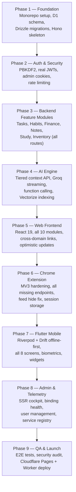

# 🌌 LifeSolver Recreation — Architectural Master Specification

> **Document Version:** 3.2.0 (Omniscient Life OS Architecture — 8 Core Verticals, Violet/Indigo Theme, Zero-Emoji Design)
> **Source Project:** LifeSolver (Orbit SaaS Monorepo)
> **Target:** Complete From-Scratch Recreation — Production-Grade, Cloudflare End-to-End, Zero Technical Debt, Feature-Parity Across All Clients.
> **Clients Covered:** `frontend/` (React 19 + Vite + Tailwind v4), `backend/` (Cloudflare Worker Hono + Drizzle), `extension/` (Chrome MV3), `flutter/` (Android/iOS), `database/` (D1 + Vectorize).
> **UI Aesthetic:** Cyber-Violet & Deep Indigo, Obsidian Dark & Crisp Snow Light modes, 100% Lucide React icons (zero emojis).

---

## 1. Executive Overview & Product Vision

### 1.1 What is LifeSolver?

**LifeSolver** is an omniscient, interconnected **Personal Operating System (Life OS)** — a unified command center replacing disjointed apps (Notion, Todoist, Anki, Mint, Day One, Cold Turkey). It consolidates all aspects of daily planning, execution, learning, health, and wealth into **8 cohesive Core Verticals** accessed via a **Unified Daily Command Center**:

| # | Vertical | Integrated Modules & Capabilities | Primary Value |
|---|---|---|---|
| 1 | **Planner** | Tasks, Hierarchical Subtasks, Kanban, Calendar & Time Blocking, Long-term Goals, Milestones | Seamless daily scheduling and execution from high-level aspirations to daily time blocks |
| 2 | **Mind** | Markdown Knowledge Base, Second Brain (Bookmarks, PDFs, Reading List), Bi-directional SM-2 Spaced Repetition Flashcards, Daily Journal & Mood Tracker | Frictionless capture, permanent retention via spaced repetition, and psychological self-reflection |
| 3 | **Finance** | Dual Cash Ledgers, Spending Budgets, Savings Pots, Bills & Recurring Subscriptions, Isolated Loan & Debt Tracker (Taken/Given) | Real-time wealth control, automated bill alerts, and debt settlement tracking without skewing cash balances |
| 4 | **Health** | Behavioral Habits & Streaks, Gym Workouts (Routines, Logs, Rest), Minimalist Habit-Style Nutrition & Recovery Scorecard (Water, Protein, Sleep, Energy) | Frictionless wellness metrics without tedious ingredient logging |
| 5 | **Focus** | Pomodoro & Deep Work Timers, Chrome Extension Screen Time & Distraction Blocker Sync, Dopamine Detox, Feed Eradicator | Reclaiming cognitive attention with cross-device edge telemetry |
| 6 | **Assets** | Physical Inventory, Equipment Servicing History, Warranty Reminders, Zero-Knowledge Document Vault (Client-Side AES-GCM-256) | Safeguarding valuable equipment, warranties, and sensitive personal papers with total privacy |
| 7 | **Network** | People & Important Dates (Birthdays, Anniversaries), Personal Commitments, Outreach Reminders | Nurturing important personal and professional relationships with privacy controls |
| 8 | **Copilot** | Orbit AI Omniscient Engine, Natural Language Multi-Intent Entry, Action Preview & Approval Cards, Context-Aware Proactive Briefings | A unified intelligence layer that coordinates all 7 verticals without destructive auto-actions |

---

## 2. Mobile Framework Choice: Flutter

**Decision: Flutter (Dart)** — chosen over React Native for the following reasons:

| Criteria | Flutter | React Native |
|---|---|---|
| **Performance** | Compiled to native ARM via Skia/Impeller — no JavaScript bridge | JS bridge overhead, especially for animations |
| **Offline-first** | `drift` (SQLite) + outbox queue — mature, type-safe | `WatermelonDB` works but less ergonomic |
| **Design fidelity** | Custom pixel-perfect renders; cyber-noir glassmorphic UI trivially achievable | Relies on native components; platform inconsistencies |
| **Code sharing** | Complete Dart codebase; shares OpenAPI types via `context/` | Could share TS types, but adds build complexity |
| **Ecosystem maturity** | Riverpod 2.x, GoRouter, Drift, local_auth, home_widget — all production-ready | React Query Native, MMKV — solid but more setup |
| **Existing foundation** | Existing `flutter/` code, routes, and auth already in Dart | Full rewrite in a new language/toolchain |

---

## 3. Infrastructure: Cloudflare End-to-End

Every service, edge function, asset, and data store runs on Cloudflare's network. No external hosting required.

| Service | Cloudflare Product | Purpose |
|---|---|---|
| **Frontend hosting** | Cloudflare Pages | Static React app (CDN edge cache globally) |
| **Backend API** | Cloudflare Workers | Hono-based REST API (`api.lifesolver.app`) |
| **Primary Database** | Cloudflare D1 (SQLite) | Relational data — all 24 tables |
| **Replication / Fallback** | Turso libSQL (HTTP pipeline) | D1 replica for disaster recovery |
| **Object Storage** | Cloudflare R2 | Profile images, note attachments, exports |
| **Vector Search** | Cloudflare Vectorize | Semantic note and study content search for AI RAG |
| **Queues (Async)** | Cloudflare Queues | D1->Turso background sync, email delivery, AI tasks |
| **Cache Layer** | Cloudflare Workers KV | Session data, AI context cache (60s TTL), rate limit counters |
| **Edge AI Inference** | Cloudflare Workers AI | On-edge Llama 3.1 for lightweight prompts |
| **Email Delivery** | SendPulse SMTP (via Worker) | OTP, verification, detox unlock emails |
| **AI Cascade (primary)** | Groq API (LLaMA-3.3-70B) | Primary chat completions — fast inference |
| **AI Cascade (fallback)** | HuggingFace Inference API | Fallback; Qwen-3.5-122B — with 30s timeout |
| **Domain / DNS / TLS** | Cloudflare DNS + Proxy | Auto TLS, DDoS protection, WAF |
| **Image Backup** | ImgBB API (async via Queue) | Secondary image CDN replication |

### 3.1 Domain Layout

```
lifesolver.app          -> Cloudflare Pages (frontend)
api.lifesolver.app      -> Cloudflare Worker (backend)
lifesolver.app/adm      -> SSR Admin Matrix (served by Worker via Pages redirect rule)
```

---

## 4. Monorepo Structure & Layout Convention

### 4.1 Root Layout

```
LifeSolver/                            # Git monorepo root
├── frontend/                          # React 19 + Vite web app (Cloudflare Pages)
├── backend/                           # Cloudflare Worker API (Hono + Drizzle ORM)
├── extension/                         # Chrome Extension Manifest V3
├── flutter/                           # Flutter 3.x mobile app (Android + iOS)
├── database/                          # Schema, migrations, seeds (Drizzle Kit)
├── context/                           # Project-wide context docs & planning artifacts
├── scripts/                           # Dev orchestration, deployment helpers
├── package.json                       # Root workspace (pnpm workspaces)
├── pnpm-workspace.yaml
└── turbo.json                         # Turborepo pipeline (optional, for build caching)
```

### 4.2 The Feature-File Convention

**The cardinal rule:** Every feature domain maps to exactly one file (or named folder) per client layer. The file path mirrors the feature domain across all clients. Adding a new feature requires creating parallel files — one in each relevant layer.

**Pattern:**
```
<layer>/<Domain>/<FeatureName>
```

**Example — Finance > Transaction History:**

```
frontend/Finance/TransactionHistory.tsx          # React page/component
backend/Finance/TransactionHistory.ts            # Hono route handler
database/Finance/TransactionHistory.sql          # DDL + seed SQL for this feature
extension/Finance/TransactionHistory.ts          # Extension content/background module
flutter/Finance/TransactionHistory.dart          # Flutter screen + provider

# Admin mirrors (every feature gets an admin face)
frontend/Admin/Finance/TransactionHistory.tsx    # Admin view of transaction history
backend/Admin/Finance/TransactionHistory.ts      # Admin-only route handler
database/Admin/Finance/TransactionHistory.sql    # Admin-specific queries/views
```

**Example — Tasks > Kanban:**

```
frontend/Tasks/Kanban.tsx
backend/Tasks/Kanban.ts
database/Tasks/Kanban.sql
extension/Tasks/Kanban.ts                        # (if relevant to extension)
flutter/Tasks/Kanban.dart
frontend/Admin/Tasks/Kanban.tsx
backend/Admin/Tasks/Kanban.ts
```

This convention makes it trivially obvious where to look for any feature's code, regardless of which layer you're working in.

---

## 5. Complete Folder Topology

### 5.1 `frontend/` — React 19 + Vite + Tailwind v4

```
frontend/
├── package.json
├── vite.config.ts
├── wrangler.toml                         # Cloudflare Pages config
├── index.html
├── src/
│   ├── main.tsx                          # Root mount, TanStack Query, idb-keyval persister
│   ├── App.tsx                           # BrowserRouter, routes, providers
│   ├── index.css                         # Cyber-noir dark theme, CSS tokens, Tailwind v4
│   │
│   ├── _core/                            # App-wide singletons
│   │   ├── AuthContext.tsx               # JWT session, login/logout
│   │   ├── AIContext.tsx                 # Floating AI bubble, page-context injector
│   │   ├── LanguageContext.tsx           # Language switcher (en / bn)
│   │   ├── api.ts                        # Global fetch wrapper (Bearer injection, JSON parsing)
│   │   ├── queryClient.ts                # TanStack Query client config
│   │   └── translations.ts               # en / bn dictionary
│   │
│   ├── Auth/
│   │   ├── LoginPage.tsx
│   │   ├── RegisterPage.tsx
│   │   ├── VerifyOtpPage.tsx
│   │   └── ForgotPasswordPage.tsx
│   │
│   ├── Dashboard/
│   │   └── DashboardPage.tsx             # Executive summary cards, Recharts
│   │
│   ├── Tasks/
│   │   ├── TasksPage.tsx                 # Parent shell (list / kanban / calendar view switcher)
│   │   ├── ListView.tsx
│   │   ├── Kanban.tsx
│   │   ├── CalendarView.tsx
│   │   ├── DateStrip.tsx
│   │   ├── TaskModal.tsx
│   │   ├── SubtaskSheet.tsx
│   │   ├── TimeTracker.tsx
│   │   └── hooks/useTasks.ts
│   │
│   ├── Habits/
│   │   ├── HabitsPage.tsx
│   │   ├── HabitCard.tsx
│   │   ├── Heatmap.tsx
│   │   ├── HabitCoach.tsx                # AI coaching panel
│   │   └── hooks/useHabits.ts
│   │
│   ├── Finance/
│   │   ├── FinancePage.tsx               # Ledger tabs + budget panel
│   │   ├── RegularLedger.tsx
│   │   ├── SpecialLedger.tsx
│   │   ├── TransactionHistory.tsx        <- feature file
│   │   ├── BudgetCard.tsx
│   │   ├── SavingsGoal.tsx
│   │   ├── StatementExport.tsx           # jsPDF exporter
│   │   └── hooks/useFinance.ts
│   │
│   ├── Notes/
│   │   ├── NotesPage.tsx
│   │   ├── NoteCard.tsx
│   │   ├── MarkdownEditor.tsx
│   │   ├── NoteEnhancer.tsx              # AI note enhancement panel
│   │   └── hooks/useNotes.ts
│   │
│   ├── Study/
│   │   ├── StudyPage.tsx
│   │   ├── SubjectAccordion.tsx
│   │   ├── ChapterRow.tsx
│   │   ├── PartItem.tsx
│   │   ├── PresetModal.tsx
│   │   ├── ImportToTasks.tsx
│   │   └── hooks/useStudy.ts
│   │
│   ├── Inventory/
│   │   ├── InventoryPage.tsx
│   │   ├── AssetCard.tsx
│   │   ├── WarrantyBadge.tsx
│   │   ├── SmartFill.tsx                 # AI form auto-filler
│   │   └── hooks/useInventory.ts
│   │
│   ├── AI/
│   │   ├── AiPage.tsx                    # Standalone AI chat
│   │   ├── FloatingOrbit.tsx             # God-mode floating trigger
│   │   ├── ChatInterface.tsx
│   │   ├── DailyBriefing.tsx
│   │   ├── core/                         # Groq client, personality prompt, types
│   │   └── modules/                      # Domain dispatchers (tasks, habits, finance, etc.)
│   │
│   ├── Settings/
│   │   ├── SettingsPage.tsx
│   │   ├── ProfileSection.tsx
│   │   ├── ThemeSection.tsx
│   │   ├── CurrencySection.tsx
│   │   └── DockShortcuts.tsx
│   │
│   ├── Admin/                            # Admin client views
│   │   ├── AdminShell.tsx                # Auth gate + layout for /adm
│   │   ├── Dashboard/
│   │   │   └── AdminDashboard.tsx
│   │   ├── Finance/
│   │   │   └── TransactionHistory.tsx    <- admin mirror
│   │   ├── Tasks/
│   │   │   └── AllTasks.tsx
│   │   ├── Users/
│   │   │   └── UserTable.tsx
│   │   └── Telemetry/
│   │       └── BindingsGrid.tsx
│   │
│   └── System/
│       └── SystemDashboard.tsx           # Edge telemetry + benchmarks
```

### 5.2 `backend/` — Cloudflare Worker + Hono + Drizzle ORM

```
backend/
├── package.json
├── wrangler.toml                         # D1, R2, KV, Vectorize, Queue bindings
├── src/
│   ├── index.ts                          # Worker entry, Hono app, CORS, JWT middleware
│   ├── types.ts                          # Env bindings, RequestContext, Hono generics
│   │
│   ├── _core/
│   │   ├── auth.middleware.ts            # JWT verification (HMAC-SHA256, expiry)
│   │   ├── admin.middleware.ts           # Admin cookie-session verification
│   │   ├── rate-limit.ts                 # KV-backed sliding window rate limiter
│   │   ├── response.ts                   # jsonOk(), jsonError(), streamResponse()
│   │   ├── db.ts                         # Drizzle ORM D1 client factory
│   │   └── queue.ts                      # Cloudflare Queue producer helper
│   │
│   ├── _routers/                         # *** Provider Abstraction Layer ***
│   │   ├── DatabaseRouter.ts             # DB adapter: 'd1' | 'turso' | 'neon' | 'hyperdrive'
│   │   ├── AiRouter.ts                   # AI adapter: 'groq' | 'openai' | 'anthropic' | 'workers-ai' | 'huggingface'
│   │   ├── ImageRouter.ts                # Image adapter: 'r2' | 'imgbb' | 'cloudflare-images' | 's3'
│   │   ├── EmailRouter.ts                # Email adapter: 'sendpulse' | 'resend' | 'mailgun'
│   │   ├── VectorRouter.ts               # Vector adapter: 'vectorize' | 'pinecone' | 'weaviate'
│   │   └── StorageRouter.ts              # General file adapter: 'r2' | 's3' | 'gcs'
│   │
│   ├── Auth/
│   │   ├── Register.ts                   # POST /api/auth/register (PBKDF2)
│   │   ├── VerifyOtp.ts                  # POST /api/auth/verify-otp
│   │   ├── Login.ts                      # POST /api/auth/login
│   │   ├── ForgotPassword.ts
│   │   └── ResetPassword.ts
│   │
│   ├── Tasks/
│   │   ├── List.ts                       # GET /api/tasks
│   │   ├── Create.ts                     # POST /api/tasks
│   │   ├── Update.ts                     # PUT /api/tasks/:id
│   │   ├── Delete.ts                     # DELETE /api/tasks/:id
│   │   ├── BatchCreate.ts                # POST /api/tasks/batch-create
│   │   ├── Subtasks.ts
│   │   ├── TimeLog.ts
│   │   └── Kanban.ts                     # PATCH /api/tasks/:id/status
│   │
│   ├── Habits/
│   │   ├── List.ts
│   │   ├── Create.ts
│   │   ├── Update.ts
│   │   ├── Delete.ts
│   │   ├── Complete.ts                   # POST /api/habits/:id/complete (server-computed streak)
│   │   └── History.ts                    # GET /api/habits/:id/history (30-day logs)
│   │
│   ├── Finance/
│   │   ├── List.ts
│   │   ├── Create.ts
│   │   ├── Update.ts
│   │   ├── Delete.ts
│   │   ├── TransactionHistory.ts         <- feature file (GET /api/finance/history)
│   │   ├── Budgets.ts
│   │   ├── SavingsDeposit.ts
│   │   └── StatementExport.ts
│   │
│   ├── Notes/
│   │   ├── List.ts
│   │   ├── Create.ts
│   │   ├── Update.ts
│   │   ├── Delete.ts
│   │   ├── Archive.ts
│   │   └── Trash.ts
│   │
│   ├── Study/
│   │   ├── Subjects.ts
│   │   ├── Chapters.ts
│   │   ├── Parts.ts
│   │   ├── Presets.ts
│   │   └── ImportToTasks.ts
│   │
│   ├── Inventory/
│   │   ├── List.ts
│   │   ├── Create.ts
│   │   ├── Update.ts
│   │   ├── Delete.ts
│   │   └── MarkSold.ts
│   │
│   ├── AI/
│   │   ├── Chat.ts                       # POST /api/ai/chat (SSE streaming)
│   │   ├── Context.ts                    # POST /api/ai/context (tiered context synthesis)
│   │   ├── SmartFill.ts                  # POST /api/ai/smart-fill
│   │   └── Enhance.ts                    # POST /api/ai/enhance-note
│   │
│   ├── Upload/
│   │   └── ImageUpload.ts                # POST /api/upload (R2 + ImgBB queue)
│   │
│   ├── Data/
│   │   └── Bootstrap.ts                  # GET /api/data/all (paginated hydration)
│   │
│   ├── Extension/
│   │   ├── Sync.ts                       # POST /api/extension/sync
│   │   ├── FrictionLog.ts                # POST /api/extension/friction
│   │   └── DetoxOtp.ts                   # POST /api/extension/detox-otp/request & /verify
│   │
│   ├── System/
│   │   └── HealthCheck.ts                # GET /api/system/probe
│   │
│   └── Admin/                            # Admin-only routes (admin.middleware protected)
│       ├── Dashboard.ts
│       ├── Finance/
│       │   └── TransactionHistory.ts     <- admin mirror (GET /adm/api/finance/history)
│       ├── Tasks/
│       │   └── AllTasks.ts
│       ├── Users/
│       │   └── UserTable.ts
│       └── Telemetry/
│           ├── DatabaseInspector.ts
│           └── ServiceRegistry.ts
```

### 5.3 `database/` — Drizzle ORM Schema + SQL Migrations

```
database/
├── drizzle.config.ts                     # Drizzle Kit config (D1 target)
├── migrations/                           # Auto-generated by drizzle-kit generate
│   ├── 0001_initial.sql
│   └── ...
├── schema/                               # Drizzle table definitions (TypeScript)
│   ├── _core/
│   │   ├── users.ts
│   │   ├── settings.ts
│   │   └── otps.ts
│   ├── Tasks/
│   │   ├── tasks.ts
│   │   └── task_time_logs.ts
│   ├── Habits/
│   │   ├── habits.ts
│   │   └── habit_logs.ts
│   ├── Finance/
│   │   ├── finance.ts
│   │   ├── budgets.ts
│   │   └── TransactionHistory.ts         <- DDL + index for this feature
│   ├── Notes/
│   │   └── notes.ts
│   ├── Study/
│   │   ├── study_subjects.ts
│   │   ├── study_chapters.ts
│   │   ├── study_parts.ts
│   │   └── study_presets.ts
│   ├── Inventory/
│   │   └── inventory.ts
│   └── Extension/
│       ├── extension_usage.ts
│       ├── friction_events.ts
│       └── journal_entries.ts
│
├── Finance/
│   └── TransactionHistory.sql            <- Raw SQL queries / views for this feature
├── Admin/
│   └── Finance/
│       └── TransactionHistory.sql        <- Admin-specific SQL views/queries
└── seeds/
    └── seed.ts
```

### 5.4 `extension/` — Chrome Manifest V3

```
extension/
├── manifest.json                         # MV3, <all_urls>, storage, alarms, declarativeNetRequest
├── package.json
├── vite.config.ts                        # Multi-entry: popup, background, content
├── src/
│   ├── background/
│   │   └── ServiceWorker.ts              # Domain time tracking (chrome.storage.session)
│   │
│   ├── content/
│   │   ├── content.ts
│   │   ├── content.css
│   │   ├── styles/
│   │   └── modules/
│   │       ├── FocusGate.ts
│   │       ├── VideoController.ts
│   │       ├── CheckoutGate.ts
│   │       ├── DetoxOverlay.ts
│   │       ├── PornBlocker.ts
│   │       ├── FrictionEngine.ts
│   │       ├── NavObserver.ts
│   │       ├── SyncAuth.ts
│   │       ├── State.ts
│   │       └── FeedHide/
│   │           └── FeedEradicator.ts
│   │
│   ├── Finance/
│   │   └── TransactionHistory.ts         <- Extension module (checkout gate budget check)
│   │
│   └── popup/
│       ├── App.tsx
│       └── tabs/
│           ├── Dashboard.tsx
│           ├── Detox.tsx
│           ├── Growth.tsx
│           └── Chat.tsx
```

### 5.5 `flutter/` — Flutter 3.x + Riverpod 2.x + Drift

```
flutter/
├── pubspec.yaml                          # flutter_riverpod, go_router, drift,
│                                         # flutter_secure_storage, local_auth,
│                                         # home_widget, dio, freezed
├── lib/
│   ├── main.dart
│   ├── app.dart                          # GoRouter, MaterialApp.router, theme
│   │
│   ├── _core/
│   │   ├── api_client.dart               # Dio + Bearer interceptor
│   │   ├── auth_provider.dart
│   │   ├── db.dart                       # Drift database + outbox sync queue
│   │   └── theme.dart                    # Cyber-noir Obsidian Dark
│   │
│   ├── Auth/
│   │   ├── LoginScreen.dart
│   │   ├── RegisterScreen.dart
│   │   ├── VerifyOtpScreen.dart
│   │   └── ForgotPasswordScreen.dart
│   │
│   ├── Dashboard/
│   │   └── DashboardScreen.dart
│   │
│   ├── Tasks/
│   │   ├── TasksScreen.dart
│   │   ├── TaskCard.dart
│   │   ├── Kanban.dart
│   │   └── tasks_provider.dart
│   │
│   ├── Habits/
│   │   ├── HabitsScreen.dart
│   │   ├── HabitCard.dart
│   │   ├── Heatmap.dart
│   │   └── habits_provider.dart
│   │
│   ├── Finance/
│   │   ├── FinanceScreen.dart
│   │   ├── TransactionHistory.dart       <- feature file
│   │   ├── BudgetCard.dart
│   │   └── finance_provider.dart
│   │
│   ├── Notes/
│   │   ├── NotesScreen.dart
│   │   ├── NoteCard.dart
│   │   └── notes_provider.dart
│   │
│   ├── Study/
│   │   ├── StudyScreen.dart
│   │   ├── SubjectTile.dart
│   │   ├── PartItem.dart
│   │   └── study_provider.dart
│   │
│   ├── Inventory/
│   │   ├── InventoryScreen.dart
│   │   ├── AssetCard.dart
│   │   └── inventory_provider.dart
│   │
│   ├── AI/
│   │   ├── AiScreen.dart
│   │   ├── ChatBubble.dart
│   │   └── ai_provider.dart
│   │
│   └── Admin/
│       └── Finance/
│           └── TransactionHistory.dart   <- admin mobile mirror
│
├── android/
└── ios/
```

### 5.6 `context/` — Project Planning & Context Artifacts

```
context/
├── README.md                             # Index of all context files
├── product-vision.md                     # Product values, target users, positioning
├── design-system.md                      # Color tokens, typography, glassmorphic rules
├── api-contracts.md                      # Endpoint: method, path, auth, body, response
├── database-schema.md                    # Entity relationship overview
├── cross-module-flows.md                 # State flow matrix (all cross-domain links)
├── feature-checklist.md                  # Feature status per client layer
├── ai-architecture.md                    # Tiered RAG context, model cascade, streaming
├── extension-spec.md                     # Extension module contracts & behavioral rules
├── flutter-spec.md                       # Flutter architecture, offline sync, widgets
├── admin-spec.md                         # Admin panel routes, telemetry, security model
├── security-model.md                     # Auth flows, PBKDF2, JWT claims, rate limiting
└── changelog.md                          # Version history
```

### 5.7 `scripts/`

```
scripts/
├── dev.js                                # Concurrently: backend (8788), frontend (5173), flutter
├── flutter-emulator.js                   # AVD booter + flutter run
├── deploy.js                             # wrangler deploy + pages deploy
├── apply-schema.js                       # drizzle-kit push to D1 + Turso
└── health-check.js                       # Terminal dashboard: D1, R2, KV, Vectorize
```

---

## 6. Tech Stack Reference

### 6.1 Frontend (`frontend/`)

| Concern | Technology |
|---|---|
| Framework | React 19 |
| Build tool | Vite 6 |
| Styling | Tailwind CSS v4 + Vanilla CSS tokens |
| UI Components | shadcn/ui (Radix primitives) |
| State / Fetching | TanStack Query v5 + idb-keyval (offline persistence) |
| Routing | React Router v7 |
| Forms | React Hook Form + Zod |
| Charts | Recharts |
| PDF export | jsPDF |
| Drag & Drop | @dnd-kit/core |
| Icons | Lucide React |
| Markdown | react-markdown + remark-gfm |
| Hosting | Cloudflare Pages |

### 6.2 Backend (`backend/`)

| Concern | Technology |
|---|---|
| Runtime | Cloudflare Workers (V8 isolates, 0ms cold start) |
| Framework | Hono v4 (routing, middleware, JSX SSR) |
| ORM | Drizzle ORM (type-safe, edge-compatible) |
| Auth | HMAC-SHA256 JWTs (@tsndr/cloudflare-worker-jwt) |
| Password | Web Crypto PBKDF2 (SHA-256, 100k iterations, random salt) |
| Database | Cloudflare D1 (primary) + Turso libSQL (replica) |
| Storage | Cloudflare R2 |
| Cache | Cloudflare Workers KV |
| Queues | Cloudflare Queues (D1->Turso sync, email, AI tasks) |
| AI Primary | Groq API — LLaMA-3.3-70B |
| AI Fallback | HuggingFace — Qwen-3.5-122B (30s timeout) |
| AI Edge | Cloudflare Workers AI (intent classification) |
| Vector Search | Cloudflare Vectorize (note/study RAG) |
| Email | SendPulse SMTP |
| Validation | Zod |

### 6.3 Chrome Extension (`extension/`)

| Concern | Technology |
|---|---|
| Manifest | V3 (service worker, declarativeNetRequest) |
| Build | Vite (multi-entry) |
| Popup UI | React 19 |
| State sync | chrome.storage.session (survives worker sleep) |
| Token sync | chrome.storage.local (JWT from web app) |

### 6.4 Flutter App (`flutter/`)

| Concern | Technology |
|---|---|
| Framework | Flutter 3.x (Dart) |
| State management | Riverpod 2.x (AsyncNotifierProvider) |
| Navigation | GoRouter (declarative, deep link) |
| Local DB | Drift (SQLite ORM, offline-first outbox sync) |
| HTTP | Dio + Riverpod interceptors |
| Secure storage | flutter_secure_storage (JWT) |
| Biometrics | local_auth |
| Widgets | home_widget (Android home screen) |
| Notifications | flutter_local_notifications |
| Code gen | freezed, build_runner, drift_dev |

### 6.5 Database (`database/`)

| Concern | Technology |
|---|---|
| Primary | Cloudflare D1 (SQLite dialect) |
| Replica | Turso libSQL (async via Queues) |
| ORM / Migrations | Drizzle ORM + Drizzle Kit |
| Vector index | Cloudflare Vectorize (1536-dim embeddings for notes) |

---

## 7. Relational Database Schema (24 Tables)

```
+--------------------+----------------------------------------------------+
|  Domain            |  Tables                                            |
+--------------------+----------------------------------------------------+
|  Core / Auth       |  users, settings, otps                             |
|  Productivity      |  tasks, task_time_logs                             |
|  Habits & Health   |  habits, habit_logs                                |
|  Wealth & Finance  |  finance, budgets, savings_transactions            |
|  Knowledge Base    |  notes                                             |
|  Academic / Study  |  study_subjects, study_chapters, study_parts,      |
|                    |  study_presets                                     |
|  Asset Management  |  inventory                                         |
|  Extension / Focus |  extension_usage, friction_events, journal_entries |
|  Sync / Queues     |  sync_outbox (Flutter local Drift only)            |
+--------------------+----------------------------------------------------+
```

### 7.1 DDL Schema

```sql
-- PRAGMA must be set on every D1 connection via Drizzle
PRAGMA foreign_keys = ON;
PRAGMA journal_mode = WAL;

-- 1. Users
CREATE TABLE users (
    id              TEXT PRIMARY KEY,           -- nanoid(21)
    name            TEXT NOT NULL,
    email           TEXT UNIQUE NOT NULL COLLATE NOCASE,
    password_hash   TEXT NOT NULL,              -- PBKDF2(SHA-256, 100k, random_salt)
    password_salt   TEXT NOT NULL,
    preferences     TEXT DEFAULT '{}',
    avatar_url      TEXT,
    is_verified     INTEGER DEFAULT 0,
    created_at      TEXT DEFAULT (datetime('now'))
);
CREATE INDEX idx_users_email ON users(email);

-- 2. User Settings
CREATE TABLE settings (
    id                      TEXT PRIMARY KEY,
    user_id                 TEXT NOT NULL UNIQUE,
    theme                   TEXT DEFAULT 'dark',
    currency                TEXT DEFAULT 'BDT',
    language                TEXT DEFAULT 'en',
    notifications_enabled   INTEGER DEFAULT 1,
    monthly_budget          REAL DEFAULT 0,
    dock_shortcuts          TEXT DEFAULT '["tasks","habits","finance","study"]',
    updated_at              TEXT DEFAULT (datetime('now')),
    FOREIGN KEY (user_id) REFERENCES users(id) ON DELETE CASCADE
);

-- 3. OTPs
CREATE TABLE otps (
    id          TEXT PRIMARY KEY,
    email       TEXT NOT NULL COLLATE NOCASE,
    otp_code    TEXT NOT NULL,
    purpose     TEXT NOT NULL CHECK(purpose IN ('verification','reset_password','detox')),
    expires_at  TEXT NOT NULL,
    attempts    INTEGER DEFAULT 0,
    created_at  TEXT DEFAULT (datetime('now'))
);
CREATE INDEX idx_otps_email_purpose ON otps(email, purpose);

-- 4. Tasks
CREATE TABLE tasks (
    id                  TEXT PRIMARY KEY,
    user_id             TEXT NOT NULL,
    title               TEXT NOT NULL,
    description         TEXT,
    status              TEXT DEFAULT 'todo'   CHECK(status IN ('todo','in-progress','done')),
    priority            TEXT DEFAULT 'medium' CHECK(priority IN ('low','medium','high','urgent')),
    due_date            TEXT,
    start_time          TEXT,
    end_time            TEXT,
    estimated_duration  INTEGER,               -- minutes
    actual_duration     INTEGER,
    context_type        TEXT DEFAULT 'general' CHECK(context_type IN ('general','study','finance','habit','project','inventory')),
    context_id          TEXT,
    budget_id           TEXT,
    expected_cost       REAL,
    finance_type        TEXT CHECK(finance_type IN ('income','expense') OR finance_type IS NULL),
    parent_task_id      TEXT,
    order_index         INTEGER DEFAULT 0,
    labels              TEXT,                  -- JSON: ["label1","label2"]
    reminder_time       TEXT,
    recurrence_rule     TEXT,
    is_pinned           INTEGER DEFAULT 0,
    completed_at        TEXT,
    created_at          TEXT DEFAULT (datetime('now')),
    FOREIGN KEY (user_id)        REFERENCES users(id) ON DELETE CASCADE,
    FOREIGN KEY (parent_task_id) REFERENCES tasks(id) ON DELETE CASCADE
);
CREATE INDEX idx_tasks_user_status ON tasks(user_id, status);
CREATE INDEX idx_tasks_user_due    ON tasks(user_id, due_date);
CREATE INDEX idx_tasks_context     ON tasks(context_type, context_id);

-- 5. Task Time Logs
CREATE TABLE task_time_logs (
    id               TEXT PRIMARY KEY,
    task_id          TEXT NOT NULL,
    user_id          TEXT NOT NULL,
    start_time       TEXT NOT NULL,
    end_time         TEXT,
    duration_seconds INTEGER,
    notes            TEXT,
    created_at       TEXT DEFAULT (datetime('now')),
    FOREIGN KEY (task_id)  REFERENCES tasks(id) ON DELETE CASCADE,
    FOREIGN KEY (user_id)  REFERENCES users(id) ON DELETE CASCADE
);
CREATE INDEX idx_time_logs_task ON task_time_logs(task_id);

-- 6. Habits
CREATE TABLE habits (
    id                  TEXT PRIMARY KEY,
    user_id             TEXT NOT NULL,
    habit_name          TEXT NOT NULL,
    streak_count        INTEGER DEFAULT 0,
    best_streak         INTEGER DEFAULT 0,
    last_completed_date TEXT,
    frequency           TEXT DEFAULT 'daily',
    target_days         TEXT,                  -- JSON: [1,3,5]
    category            TEXT DEFAULT 'general',
    created_at          TEXT DEFAULT (datetime('now')),
    FOREIGN KEY (user_id) REFERENCES users(id) ON DELETE CASCADE
);
CREATE INDEX idx_habits_user ON habits(user_id);

-- 7. Habit Logs (server-computed streaks — no client trust)
CREATE TABLE habit_logs (
    id              TEXT PRIMARY KEY,
    habit_id        TEXT NOT NULL,
    user_id         TEXT NOT NULL,
    completed_date  TEXT NOT NULL,             -- 'YYYY-MM-DD'
    created_at      TEXT DEFAULT (datetime('now')),
    UNIQUE (habit_id, completed_date),
    FOREIGN KEY (habit_id) REFERENCES habits(id) ON DELETE CASCADE,
    FOREIGN KEY (user_id)  REFERENCES users(id)  ON DELETE CASCADE
);
CREATE INDEX idx_habit_logs_user_date ON habit_logs(user_id, completed_date);

-- 8. Finance Ledger
CREATE TABLE finance (
    id          TEXT PRIMARY KEY,
    user_id     TEXT NOT NULL,
    type        TEXT NOT NULL CHECK(type IN ('income','expense')),
    amount      REAL NOT NULL CHECK(amount > 0),
    category    TEXT NOT NULL,
    description TEXT,
    date        TEXT DEFAULT (date('now')),
    is_special  INTEGER DEFAULT 0,             -- 1 = high-ticket capital ledger
    budget_id   TEXT,
    task_id     TEXT,
    created_at  TEXT DEFAULT (datetime('now')),
    FOREIGN KEY (user_id)   REFERENCES users(id)   ON DELETE CASCADE,
    FOREIGN KEY (budget_id) REFERENCES budgets(id) ON DELETE SET NULL
);
CREATE INDEX idx_finance_user_date    ON finance(user_id, date);
CREATE INDEX idx_finance_user_special ON finance(user_id, is_special);

-- 9. Budgets & Savings Goals
CREATE TABLE budgets (
    id              TEXT PRIMARY KEY,
    user_id         TEXT NOT NULL,
    name            TEXT NOT NULL,
    type            TEXT NOT NULL CHECK(type IN ('budget','savings')),
    target_amount   REAL NOT NULL CHECK(target_amount >= 0),
    current_amount  REAL DEFAULT 0,
    period          TEXT CHECK(period IN ('monthly','weekly','yearly') OR period IS NULL),
    category        TEXT,
    start_date      TEXT,
    deadline_date   TEXT,
    is_special      INTEGER DEFAULT 0,
    created_at      TEXT DEFAULT (datetime('now')),
    FOREIGN KEY (user_id) REFERENCES users(id) ON DELETE CASCADE
);
CREATE INDEX idx_budgets_user ON budgets(user_id);

-- 10. Savings Transactions
CREATE TABLE savings_transactions (
    id          TEXT PRIMARY KEY,
    savings_id  TEXT NOT NULL,
    user_id     TEXT NOT NULL,
    type        TEXT NOT NULL CHECK(type IN ('deposit','withdraw')),
    amount      REAL NOT NULL CHECK(amount > 0),
    description TEXT,
    date        TEXT NOT NULL,
    created_at  TEXT DEFAULT (datetime('now')),
    FOREIGN KEY (savings_id) REFERENCES budgets(id) ON DELETE CASCADE,
    FOREIGN KEY (user_id)    REFERENCES users(id)   ON DELETE CASCADE
);
CREATE INDEX idx_savings_tx ON savings_transactions(savings_id);

-- 11. Notes
CREATE TABLE notes (
    id            TEXT PRIMARY KEY,
    user_id       TEXT NOT NULL,
    title         TEXT NOT NULL,
    content       TEXT DEFAULT '',
    tags          TEXT,                        -- JSON: ["tag1","tag2"]
    is_pinned     INTEGER DEFAULT 0,
    color         TEXT DEFAULT 'default',
    is_archived   INTEGER DEFAULT 0,
    is_trashed    INTEGER DEFAULT 0,
    serial_number INTEGER DEFAULT 0,
    updated_at    TEXT DEFAULT (datetime('now')),
    created_at    TEXT DEFAULT (datetime('now')),
    FOREIGN KEY (user_id) REFERENCES users(id) ON DELETE CASCADE
);
CREATE INDEX idx_notes_user_state ON notes(user_id, is_trashed, is_archived);

-- 12. Study Subjects
CREATE TABLE study_subjects (
    id          TEXT PRIMARY KEY,
    user_id     TEXT NOT NULL,
    name        TEXT NOT NULL,
    color_index INTEGER DEFAULT 0,
    created_at  TEXT DEFAULT (datetime('now')),
    FOREIGN KEY (user_id) REFERENCES users(id) ON DELETE CASCADE
);
CREATE INDEX idx_study_subjects_user ON study_subjects(user_id);

-- 13. Study Chapters
CREATE TABLE study_chapters (
    id          TEXT PRIMARY KEY,
    user_id     TEXT NOT NULL,
    subject_id  TEXT NOT NULL,
    name        TEXT NOT NULL,
    sort_order  INTEGER DEFAULT 0,
    created_at  TEXT DEFAULT (datetime('now')),
    FOREIGN KEY (subject_id) REFERENCES study_subjects(id) ON DELETE CASCADE,
    FOREIGN KEY (user_id)    REFERENCES users(id)          ON DELETE CASCADE
);
CREATE INDEX idx_study_chapters_subject ON study_chapters(subject_id);

-- 14. Study Parts (recursive)
CREATE TABLE study_parts (
    id                TEXT PRIMARY KEY,
    user_id           TEXT NOT NULL,
    chapter_id        TEXT NOT NULL,
    parent_id         TEXT,
    name              TEXT NOT NULL,
    status            TEXT DEFAULT 'not-started' CHECK(status IN ('not-started','in-progress','completed')),
    estimated_minutes INTEGER DEFAULT 30,
    scheduled_date    TEXT,
    scheduled_time    TEXT,
    notes             TEXT,
    sort_order        INTEGER DEFAULT 0,
    completed_at      TEXT,
    created_at        TEXT DEFAULT (datetime('now')),
    FOREIGN KEY (chapter_id) REFERENCES study_chapters(id) ON DELETE CASCADE,
    FOREIGN KEY (parent_id)  REFERENCES study_parts(id)   ON DELETE CASCADE,
    FOREIGN KEY (user_id)    REFERENCES users(id)          ON DELETE CASCADE
);
CREATE INDEX idx_study_parts_chapter ON study_parts(chapter_id);

-- 15. Study Presets / Syllabus Templates
CREATE TABLE study_presets (
    id                TEXT PRIMARY KEY,
    user_id           TEXT NOT NULL,
    subject_id        TEXT NOT NULL,
    name              TEXT NOT NULL,
    estimated_minutes INTEGER DEFAULT 30,
    preset_type       TEXT DEFAULT 'chapter' CHECK(preset_type IN ('chapter','part')),
    parent_id         TEXT,
    created_at        TEXT DEFAULT (datetime('now')),
    FOREIGN KEY (subject_id) REFERENCES study_subjects(id) ON DELETE CASCADE,
    FOREIGN KEY (user_id)    REFERENCES users(id)          ON DELETE CASCADE
);

-- 16. Inventory
CREATE TABLE inventory (
    id               TEXT PRIMARY KEY,
    user_id          TEXT NOT NULL,
    item_name        TEXT NOT NULL,
    category         TEXT DEFAULT 'Other',
    quantity         INTEGER DEFAULT 1 CHECK(quantity >= 0),
    cost             REAL CHECK(cost >= 0),
    purchase_date    TEXT,
    store            TEXT,
    notes            TEXT,
    status           TEXT DEFAULT 'active' CHECK(status IN ('active','maintenance','sold','discarded')),
    warranty_expiry  TEXT,
    finance_entry_id TEXT,
    created_at       TEXT DEFAULT (datetime('now')),
    FOREIGN KEY (user_id)          REFERENCES users(id)   ON DELETE CASCADE,
    FOREIGN KEY (finance_entry_id) REFERENCES finance(id) ON DELETE SET NULL
);
CREATE INDEX idx_inventory_user ON inventory(user_id);

-- 17. Extension Usage Telemetry
CREATE TABLE extension_usage (
    id               TEXT PRIMARY KEY,
    user_id          TEXT NOT NULL,
    domain           TEXT NOT NULL,
    duration_seconds INTEGER NOT NULL,
    date             TEXT NOT NULL,
    created_at       TEXT DEFAULT (datetime('now')),
    FOREIGN KEY (user_id) REFERENCES users(id) ON DELETE CASCADE
);
CREATE INDEX idx_ext_usage_user_date ON extension_usage(user_id, date);

-- 18. Friction Events
CREATE TABLE friction_events (
    id          TEXT PRIMARY KEY,
    user_id     TEXT NOT NULL,
    domain      TEXT NOT NULL,
    event_type  TEXT NOT NULL,
    metadata    TEXT,                          -- JSON
    created_at  TEXT DEFAULT (datetime('now')),
    FOREIGN KEY (user_id) REFERENCES users(id) ON DELETE CASCADE
);

-- 19. Journal Entries (Focus Gates)
CREATE TABLE journal_entries (
    id          TEXT PRIMARY KEY,
    user_id     TEXT NOT NULL,
    prompt      TEXT NOT NULL,
    content     TEXT NOT NULL,
    domain      TEXT,
    created_at  TEXT DEFAULT (datetime('now')),
    FOREIGN KEY (user_id) REFERENCES users(id) ON DELETE CASCADE
);

-- 20. Flutter Offline Outbox (Drift local SQLite only — NOT synced to D1)
CREATE TABLE sync_outbox (
    id          INTEGER PRIMARY KEY AUTOINCREMENT,
    method      TEXT NOT NULL,                 -- 'POST' | 'PUT' | 'DELETE'
    endpoint    TEXT NOT NULL,
    payload     TEXT,                          -- JSON body
    retry_count INTEGER DEFAULT 0,
    created_at  TEXT DEFAULT (datetime('now'))
);
```

---

## 8. Security Architecture

All critical vulnerabilities from the original codebase are eliminated in the recreation:

| # | Vulnerability (Original) | Fix (Recreation) |
|---|---|---|
| 1 | Mock JWT with `mock_signature` — no verification | Real HMAC-SHA256 JWTs via `@tsndr/cloudflare-worker-jwt`, verified on every request |
| 2 | Hardcoded admin backdoor passwords | Admin sessions via time-limited HMAC-SHA256 signed cookies + passkey challenge |
| 3 | `GET /api/system/admin/users` unauthenticated | All admin routes behind `admin.middleware.ts` cookie verification |
| 4 | Unauthenticated file upload + stored XSS | Auth required on `/api/upload`, magic-byte MIME validation, Content-Disposition headers |
| 5 | Unauthenticated AI proxy | JWT middleware covers all `/api/ai/*` routes |
| 6 | SQL injection in dynamic handler | Drizzle ORM parameterized queries — zero string concatenation |
| 7 | Single-iteration SHA-256 + static salt | PBKDF2 (SHA-256, 100,000 iterations, unique 16-byte random salt per user) |
| 8 | Login bypass on null password hash | Explicit NOT NULL constraint + constant-time comparison |
| 9 | Client-controlled habit streaks | Streak computed server-side from `habit_logs` on every `/complete` call |
| 10 | Client-controlled financial balances | Server reads actual DB rows for delta; client cannot supply `oldAmount` |
| 11 | D1->Turso split-brain (silent failure) | Cloudflare Queues with retry + dead-letter queue; D1 is authoritative source of truth |
| 12 | Missing `PRAGMA foreign_keys = ON` | Set on every Drizzle connection in `db.ts` |
| 13 | Extension OTP routes missing (permanent lockout) | `DetoxOtp.ts` fully implemented in backend |
| 14 | Extension sync route rejected (HTTP 400) | `Extension/Sync.ts` is a proper named Hono route |

---

## 9. AI Architecture: Tiered RAG + Streaming

### 9.1 Context Synthesis Pipeline (`POST /api/ai/context`)

The AI never receives raw dumps of all user data. A 3-tier pipeline builds a compact context:

```
Tier 1 — Global Aggregates (~150 tokens, cached 60s in KV)
  SELECT COUNT(*) tasks, COUNT(*) habits, SUM(amount) income, ...

Tier 2 — Intent-Targeted Slices (~500 tokens, no cache)
  Classify intent -> fetch only the relevant domain slice
  e.g. "how are my habits?" -> last 7 habit_logs + streaks only

Tier 3 — Vector Search (~500 tokens, on-demand)
  Query Cloudflare Vectorize with user prompt embedding
  -> top-5 relevant notes or study parts returned
```

Total context per turn: **< 1,250 tokens** (vs. >1,000,000 tokens in the original).

### 9.2 Model Cascade

```
Primary:  Groq API — LLaMA-3.3-70B (fast, 128k ctx, function calling)
Fallback: HuggingFace — Qwen-3.5-122B (30s timeout — not 6s as in original)
Edge:     Cloudflare Workers AI — Llama 3.1 8B (lightweight intent classification)
```

### 9.3 Streaming

All chat responses use `ReadableStream` SSE from the Worker:
```
POST /api/ai/chat  ->  Content-Type: text/event-stream
```

### 9.4 Structured Output (Tool Calling)

Instead of regex-parsing freeform JSON, all mutation actions use OpenAI-compatible function calling with typed schemas. The model invokes named tools (`create_task`, `log_expense`, `toggle_habit`) which the Worker executes directly against D1.

---

## 10. Cross-Module Integration Matrix

All cross-domain links are handled **server-side** — not by client-side loops.

| Origin | Target | Trigger | Mechanism |
|---|---|---|---|
| **Tasks** | **Finance** | Task with `context_type='finance'` marked `done` | Worker auto-creates `finance` row |
| **Tasks** | **Habits** | Task with `context_type='habit'` marked `done` | Worker inserts `habit_logs` row, recomputes streak |
| **Tasks** | **Study** | Task with `context_type='study'` marked `done` | Worker sets `study_parts.status = 'completed'` |
| **Study** | **Tasks** | "Import Chapter to Tasks" clicked | `POST /api/study/import-to-tasks` -> batch-create with subtasks |
| **Inventory** | **Finance** | Asset created with "Record Purchase" | Worker creates `finance` expense row, stores `finance_entry_id` |
| **Inventory** | **Finance** | Asset marked "Sold" | Worker creates `finance` income row |
| **Inventory** | **Tasks** | "Schedule Maintenance" clicked | Frontend navigation with pre-filled task state |
| **Extension** | **Finance** | Checkout Gate intercepts cart | Reads `budgets` + `finance` sum from backend sync |
| **Extension** | **Auth** | User visits `lifesolver.app` | `SyncAuth.ts` copies localStorage JWT -> `chrome.storage.local` |
| **AI Copilot** | **All modules** | User chat prompt | Intent classification -> targeted context -> tool calls -> D1 mutations |
| **Dashboard** | **All modules** | Page mount | `GET /api/data/all` — paginated, cursor-based |

---

## 11. Flutter: Offline-First Architecture

### 11.1 Outbox Sync Pattern

```
User Action (offline)
  -> Drift local DB write (optimistic)
  -> sync_outbox row inserted (method, endpoint, payload)

Network restored
  -> OutboxSyncService runs
  -> Flushes sync_outbox in order
  -> On success: delete outbox row
  -> On failure: increment retry_count (max 5, then dead-letter)
```

### 11.2 Riverpod Provider Tree

```dart
// Core providers
authProvider           -> JWT + FlutterSecureStorage
apiClientProvider      -> Dio with Bearer interceptor
driftDbProvider        -> Local SQLite Drift database

// Feature providers (AsyncNotifierProvider per module)
tasksProvider          -> Drift cache + API sync
habitsProvider         -> with offline outbox
financeProvider        -> with offline outbox
notesProvider
studyProvider
inventoryProvider
aiProvider             -> Groq streaming (no offline cache)
```

---

## 12. Admin Panel Specification

The admin panel lives at `/adm` — rendered server-side by the Worker via Hono JSX.

### 12.1 Authentication
- `GET /adm` — shows passkey/math challenge (not a login form)
- `POST /adm/auth` — verifies passkey -> sets HMAC-SHA256 signed cookie (2h TTL)
- All `/adm/api/*` routes verify cookie on every request

### 12.2 Dashboard Panels

| Panel | Route |
|---|---|
| Binding Health | `/adm/api/health` |
| User Metrics | `/adm/api/users` |
| Finance Overview | `/adm/api/finance/history` |
| All Tasks | `/adm/api/tasks/all` |
| Telemetry Terminal | `/adm/api/telemetry` |
| Service Registry | `/adm/api/services` |

---

## 13. Chrome Extension: MV3 Compliance Fixes

| # | Bug (Original) | Fix |
|---|---|---|
| 1 | Service worker state wiped on sleep (30s) | All tracking state in `chrome.storage.session` |
| 2 | Detox OTP endpoints missing | Backend `DetoxOtp.ts` implements both routes |
| 3 | Extension sync rejected HTTP 400 | `Extension/Sync.ts` is a proper Hono route |
| 4 | 3x `subtree:true` MutationObservers jank | Replaced with `chrome.tabs.onUpdated` + navigation API |
| 5 | `{ passive: false }` scroll blocking | Scroll resistance via CSS — no `preventDefault` |
| 6 | Feed Hide: wrong schema keys | Uses `status === 'done'` and `habit_name` (correct) |

---

## 14. Implementation Roadmap



| Phase | Scope | Priority |
|---|---|---|
| 1 | Monorepo init, D1 schema, Drizzle migrations, Hono entry point | P0 |
| 2 | Auth: PBKDF2, JWT, OTP, admin session cookies | P0 |
| 3 | All 6 domain API modules | P0 |
| 4 | AI: tiered context, Groq SSE streaming, function calling, Vectorize | P1 |
| 5 | React 19 frontend: all modules, cross-domain links, TanStack Query | P1 |
| 6 | Chrome Extension MV3: all bugs fixed, missing endpoints wired | P1 |
| 7 | Flutter: Riverpod, Drift outbox sync, all screens, widgets, biometrics | P1 |
| 8 | Admin SSR panel, telemetry, binding health, service registry | P2 |
| 9 | E2E tests, security audit, Cloudflare production deployment | P2 |

---

## 15. Context Folder Manifest

All planning artifacts live in `context/` and are updated alongside code changes:

| File | Contents |
|---|---|
| `context/product-vision.md` | Product values, target users, north-star metrics |
| `context/design-system.md` | Color tokens (cyber-noir), typography, glassmorphic rules, Tailwind config |
| `context/api-contracts.md` | Every endpoint: method, path, auth requirement, request body, response schema |
| `context/database-schema.md` | ERD overview, table relationships, index rationale |
| `context/cross-module-flows.md` | Full integration matrix with server-side flow descriptions |
| `context/feature-checklist.md` | Per-feature implementation status across all 5 clients |
| `context/ai-architecture.md` | Tiered RAG context design, model cascade, streaming, function schemas |
| `context/extension-spec.md` | Extension module contracts, behavioral gate rules, sync protocol |
| `context/flutter-spec.md` | Flutter architecture decisions, Drift schema, outbox sync, widget spec |
| `context/admin-spec.md` | Admin routes, panel sections, cookie security model |
| `context/security-model.md` | Auth flows, password hashing, JWT claims, rate limiting strategy |
| `context/changelog.md` | Version history and migration notes |

---

## 16. File Extension Convention

**Answer: `.tsx` for React components, `.ts` for everything else. Never `.jsx` or `.js`.**

This is a TypeScript-first codebase. `.js`/`.jsx` discard all type safety and should never appear.

| Extension | When to use | Examples |
|---|---|---|
| `.tsx` | Any file containing JSX markup (React components, pages, UI) | `TasksPage.tsx`, `NoteCard.tsx`, `Kanban.tsx` |
| `.ts` | TypeScript without JSX: hooks, API handlers, routers, middleware, utilities, types | `useTasks.ts`, `AiRouter.ts`, `auth.middleware.ts` |
| `.dart` | All Flutter/Dart files | `TasksScreen.dart`, `finance_provider.dart` |
| `.sql` | Raw SQL files in `database/` | `TransactionHistory.sql` |

**Rule of thumb:**
- File has `return (<SomeComponent />)` or any JSX element? → `.tsx`
- Everything else in the frontend? → `.ts`
- All backend files? Always `.ts` — Workers run TypeScript via Wrangler, no JSX in backend (Hono JSX SSR views are the only exception and they stay `.tsx`)
- Extension popup UI? → `.tsx`. Background/content scripts? → `.ts`

---

## 17. Provider Router Architecture

This is the most important architectural pattern in the codebase. Every external service — image storage, database, AI, email, vector search — is abstracted behind a **Router file** in `backend/src/_routers/`.

### 17.1 The Core Principle

The entire codebase calls the Router. The Router reads `env` (Cloudflare bindings + secrets from `dev.vars`/CF Secrets) and delegates to the active provider.

**Swapping providers = change one env var + add one `case` block in the router. Zero changes to any feature file.**

```
Notes/Create.ts  (feature handler)
       |
       v
 ImageRouter.ts  <-- reads IMAGE_PROVIDER from env
       |
  +--------+-----------+----------+
  |        |           |          |
 'r2'  'imgbb'  'cf-images'    's3'
```

### 17.2 `dev.vars` / Cloudflare Secrets Convention

Provider selection is done entirely via environment variables. In development they live in `backend/.dev.vars` (git-ignored). In production they are set as Cloudflare Worker Secrets via `wrangler secret put`.

```bash
# backend/.dev.vars  (development only — git-ignored)

# Provider Selection
IMAGE_PROVIDER=r2                 # 'r2' | 'imgbb' | 'cloudflare-images' | 's3'
DB_PRIMARY=d1                     # 'd1' | 'turso' | 'neon' | 'hyperdrive'
DB_REPLICA=turso                  # 'turso' | 'none'
AI_PROVIDER=groq                  # 'groq' | 'openai' | 'anthropic' | 'workers-ai' | 'huggingface'
AI_FALLBACK=workers-ai            # used when primary fails or rate-limits
EMAIL_PROVIDER=sendpulse          # 'sendpulse' | 'resend' | 'mailgun'
VECTOR_PROVIDER=vectorize         # 'vectorize' | 'pinecone' | 'weaviate'

# Image Provider Credentials
IMGBB_API_KEY=xxx
CLOUDFLARE_IMAGES_ACCOUNT_ID=xxx
CLOUDFLARE_IMAGES_API_TOKEN=xxx
S3_BUCKET=xxx
S3_REGION=us-east-1
S3_ACCESS_KEY_ID=xxx
S3_SECRET_ACCESS_KEY=xxx

# AI Provider Credentials
GROQ_API_KEY=xxx
OPENAI_API_KEY=xxx
ANTHROPIC_API_KEY=xxx
HUGGINGFACE_API_KEY=xxx

# Database Credentials
TURSO_DATABASE_URL=libsql://xxx.turso.io
TURSO_AUTH_TOKEN=xxx
NEON_DATABASE_URL=postgresql://xxx

# Email Credentials
SENDPULSE_API_USER=xxx
SENDPULSE_API_KEY=xxx
RESEND_API_KEY=xxx
MAILGUN_API_KEY=xxx
MAILGUN_DOMAIN=xxx

# Vector Credentials
PINECONE_API_KEY=xxx
PINECONE_INDEX=lifesolver-notes
```

### 17.3 `ImageRouter.ts`

```typescript
// backend/src/_routers/ImageRouter.ts

export type ImageProvider = 'r2' | 'imgbb' | 'cloudflare-images' | 's3';

export interface UploadResult {
  url: string;
  key: string;
  provider: ImageProvider;
}

export async function uploadImage(
  file: ArrayBuffer,
  filename: string,
  mimeType: string,
  env: Env
): Promise<UploadResult> {
  const provider = (env.IMAGE_PROVIDER ?? 'r2') as ImageProvider;

  switch (provider) {
    case 'r2': {
      const key = `uploads/${crypto.randomUUID()}-${filename}`;
      await env.R2_BUCKET.put(key, file, { httpMetadata: { contentType: mimeType } });
      return { url: `${env.R2_PUBLIC_URL}/${key}`, key, provider: 'r2' };
    }

    case 'imgbb': {
      const b64 = btoa(String.fromCharCode(...new Uint8Array(file)));
      const form = new FormData();
      form.append('image', b64);
      const res = await fetch(`https://api.imgbb.com/1/upload?key=${env.IMGBB_API_KEY}`, {
        method: 'POST', body: form,
      });
      const data = await res.json() as { data: { url: string; delete_url: string } };
      return { url: data.data.url, key: data.data.delete_url, provider: 'imgbb' };
    }

    case 'cloudflare-images': {
      const form = new FormData();
      form.append('file', new Blob([file], { type: mimeType }), filename);
      const res = await fetch(
        `https://api.cloudflare.com/client/v4/accounts/${env.CLOUDFLARE_IMAGES_ACCOUNT_ID}/images/v1`,
        { method: 'POST', headers: { Authorization: `Bearer ${env.CLOUDFLARE_IMAGES_API_TOKEN}` }, body: form }
      );
      const data = await res.json() as { result: { variants: string[] } };
      return { url: data.result.variants[0], key: filename, provider: 'cloudflare-images' };
    }

    case 's3': {
      const key = `uploads/${crypto.randomUUID()}-${filename}`;
      // S3-compatible API (also works for R2 in S3-compat mode, Backblaze B2, etc.)
      // ... SigV4 signed PUT via fetch
      return { url: `https://${env.S3_BUCKET}.s3.${env.S3_REGION}.amazonaws.com/${key}`, key, provider: 's3' };
    }

    default:
      throw new Error(`Unknown IMAGE_PROVIDER: ${provider}`);
  }
}

export async function deleteImage(key: string, env: Env): Promise<void> {
  const provider = (env.IMAGE_PROVIDER ?? 'r2') as ImageProvider;
  switch (provider) {
    case 'r2':    return void env.R2_BUCKET.delete(key);
    case 'imgbb': await fetch(key); return;  // imgbb key IS the delete URL
    // cloudflare-images, s3 deletions follow same pattern
  }
}
```

**Feature handler — zero provider awareness:**
```typescript
// backend/src/Upload/ImageUpload.ts
import { uploadImage } from '../_routers/ImageRouter';

app.post('/api/upload', authMiddleware, async (c) => {
  const file = await c.req.arrayBuffer();
  const { url } = await uploadImage(file, 'photo.jpg', 'image/jpeg', c.env);
  return c.json({ url });
  // Which provider is active? This file has no idea. That's the point.
});
```

### 17.4 `AiRouter.ts`

Routes all AI inference. Handles primary → fallback cascade, timeout management, and streaming.

```typescript
// backend/src/_routers/AiRouter.ts

export type AiProvider = 'groq' | 'openai' | 'anthropic' | 'workers-ai' | 'huggingface';

export interface AiMessage { role: 'user' | 'assistant' | 'system'; content: string; }
export interface AiTool   { name: string; description: string; parameters: object; }

export interface AiOptions {
  messages:   AiMessage[];
  tools?:     AiTool[];
  stream?:    boolean;
  maxTokens?: number;
  provider?:  AiProvider;  // optional override of env default
}

export async function callAi(options: AiOptions, env: Env): Promise<Response | unknown> {
  const primary  = (options.provider ?? env.AI_PROVIDER  ?? 'groq') as AiProvider;
  const fallback = (env.AI_FALLBACK ?? 'workers-ai') as AiProvider;

  try {
    return await _callProvider(primary, options, env);
  } catch (err) {
    console.warn(`[AiRouter] ${primary} failed: ${err}. Falling back to ${fallback}`);
    return await _callProvider(fallback, options, env);
  }
}

async function _callProvider(provider: AiProvider, opts: AiOptions, env: Env) {
  switch (provider) {
    case 'groq':
      return fetch('https://api.groq.com/openai/v1/chat/completions', {
        method: 'POST',
        headers: { Authorization: `Bearer ${env.GROQ_API_KEY}`, 'Content-Type': 'application/json' },
        body: JSON.stringify({
          model: 'llama-3.3-70b-versatile',
          messages: opts.messages, tools: opts.tools,
          stream: opts.stream ?? true, max_tokens: opts.maxTokens ?? 2048,
        }),
      });

    case 'openai':
      return fetch('https://api.openai.com/v1/chat/completions', {
        method: 'POST',
        headers: { Authorization: `Bearer ${env.OPENAI_API_KEY}`, 'Content-Type': 'application/json' },
        body: JSON.stringify({ model: 'gpt-4o-mini', messages: opts.messages, stream: opts.stream ?? true }),
      });

    case 'anthropic':
      return fetch('https://api.anthropic.com/v1/messages', {
        method: 'POST',
        headers: { 'x-api-key': env.ANTHROPIC_API_KEY, 'anthropic-version': '2023-06-01', 'Content-Type': 'application/json' },
        body: JSON.stringify({ model: 'claude-3-5-haiku-latest', messages: opts.messages, max_tokens: opts.maxTokens ?? 2048 }),
      });

    case 'workers-ai':
      // Cloudflare built-in — zero API key needed
      return env.AI.run('@cf/meta/llama-3.1-8b-instruct', { messages: opts.messages, stream: opts.stream });

    case 'huggingface': {
      const controller = new AbortController();
      const tid = setTimeout(() => controller.abort(), 30_000); // 30s — NOT 6s
      try {
        return await fetch('https://api-inference.huggingface.co/models/Qwen/Qwen2.5-72B-Instruct/v1/chat/completions', {
          method: 'POST',
          headers: { Authorization: `Bearer ${env.HUGGINGFACE_API_KEY}`, 'Content-Type': 'application/json' },
          body: JSON.stringify({ model: 'Qwen/Qwen2.5-72B-Instruct', messages: opts.messages }),
          signal: controller.signal,
        });
      } finally { clearTimeout(tid); }
    }

    default: throw new Error(`Unknown AI_PROVIDER: ${provider}`);
  }
}
```

**Feature handler:**
```typescript
// backend/src/AI/Chat.ts
import { callAi } from '../_routers/AiRouter';

app.post('/api/ai/chat', authMiddleware, async (c) => {
  const { messages } = await c.req.json();
  const stream = await callAi({ messages, stream: true }, c.env) as Response;
  return new Response(stream.body, { headers: { 'Content-Type': 'text/event-stream' } });
});
```

### 17.5 `DatabaseRouter.ts`

```typescript
// backend/src/_routers/DatabaseRouter.ts

export type DbProvider = 'd1' | 'turso' | 'neon' | 'hyperdrive';

export function getDb(env: Env, role: 'primary' | 'replica' = 'primary') {
  const provider = (
    role === 'replica' ? env.DB_REPLICA : env.DB_PRIMARY
  ) as DbProvider ?? 'd1';

  switch (provider) {
    case 'd1':
      return drizzle(env.DB, { schema });

    case 'turso': {
      const client = createClient({ url: env.TURSO_DATABASE_URL, authToken: env.TURSO_AUTH_TOKEN });
      return drizzle(client, { schema });
    }

    case 'neon':
      return drizzle(neon(env.NEON_DATABASE_URL), { schema });

    case 'hyperdrive':
      return drizzle(env.HYPERDRIVE.connectionString, { schema });

    default:
      throw new Error(`Unknown DB_PRIMARY: ${provider}`);
  }
}
```

### 17.6 `EmailRouter.ts`

```typescript
// backend/src/_routers/EmailRouter.ts

export type EmailProvider = 'sendpulse' | 'resend' | 'mailgun';

export interface EmailPayload { to: string; subject: string; html: string; }

export async function sendEmail(payload: EmailPayload, env: Env): Promise<void> {
  const provider = (env.EMAIL_PROVIDER ?? 'sendpulse') as EmailProvider;

  switch (provider) {
    case 'sendpulse':
      await fetch('https://api.sendpulse.com/smtp/emails', {
        method: 'POST',
        headers: { Authorization: `Bearer ${await getSendpulseToken(env)}`, 'Content-Type': 'application/json' },
        body: JSON.stringify({ email: { html: payload.html, subject: payload.subject, from: { name: 'LifeSolver', email: 'noreply@lifesolver.app' }, to: [{ email: payload.to }] } }),
      });
      return;

    case 'resend':
      await fetch('https://api.resend.com/emails', {
        method: 'POST',
        headers: { Authorization: `Bearer ${env.RESEND_API_KEY}`, 'Content-Type': 'application/json' },
        body: JSON.stringify({ from: 'LifeSolver <noreply@lifesolver.app>', to: [payload.to], subject: payload.subject, html: payload.html }),
      });
      return;

    case 'mailgun': {
      const form = new FormData();
      form.append('from', 'LifeSolver <noreply@lifesolver.app>');
      form.append('to', payload.to);
      form.append('subject', payload.subject);
      form.append('html', payload.html);
      await fetch(`https://api.mailgun.net/v3/${env.MAILGUN_DOMAIN}/messages`, {
        method: 'POST',
        headers: { Authorization: `Basic ${btoa(`api:${env.MAILGUN_API_KEY}`)}` },
        body: form,
      });
      return;
    }
  }
}
```

### 17.7 `VectorRouter.ts`

```typescript
// backend/src/_routers/VectorRouter.ts

export type VectorProvider = 'vectorize' | 'pinecone' | 'weaviate';

export async function upsertEmbedding(
  id: string, values: number[], metadata: Record<string, string>, env: Env
) {
  const provider = (env.VECTOR_PROVIDER ?? 'vectorize') as VectorProvider;
  switch (provider) {
    case 'vectorize':
      return env.VECTORIZE_INDEX.upsert([{ id, values, metadata }]);
    case 'pinecone':
      return fetch(`https://YOUR_INDEX.svc.pinecone.io/vectors/upsert`, {
        method: 'POST',
        headers: { 'Api-Key': env.PINECONE_API_KEY, 'Content-Type': 'application/json' },
        body: JSON.stringify({ vectors: [{ id, values, metadata }] }),
      });
  }
}

export async function queryEmbedding(vector: number[], topK: number, env: Env) {
  const provider = (env.VECTOR_PROVIDER ?? 'vectorize') as VectorProvider;
  switch (provider) {
    case 'vectorize':
      return env.VECTORIZE_INDEX.query(vector, { topK, returnMetadata: true });
    case 'pinecone':
      return fetch(`https://YOUR_INDEX.svc.pinecone.io/query`, {
        method: 'POST',
        headers: { 'Api-Key': env.PINECONE_API_KEY, 'Content-Type': 'application/json' },
        body: JSON.stringify({ vector, topK, includeMetadata: true }),
      }).then(r => r.json());
  }
}
```

### 17.8 Adding a New Provider — The 3-Step Rule

**Example: add Backblaze B2 as an image provider.**

1. Add credentials to `dev.vars` / CF Secrets:
   ```bash
   B2_KEY_ID=xxx
   B2_APP_KEY=xxx
   B2_BUCKET_NAME=lifesolver
   ```
2. Add one `case` in `ImageRouter.ts`:
   ```typescript
   case 'b2': {
     const key = `uploads/${crypto.randomUUID()}-${filename}`;
     // Backblaze B2 S3-compatible API
     return { url: `https://f000.backblazeb2.com/file/${env.B2_BUCKET_NAME}/${key}`, key, provider: 'b2' as any };
   }
   ```
3. Set `IMAGE_PROVIDER=b2` in secrets.

**Zero changes** to `Upload/ImageUpload.ts`, `Notes/Update.ts`, `Inventory/Create.ts`, or any other file.

---

## 18. Scale Strategy: 10,000+ Records

### 18.1 Pagination — Cursor-Based (Not Offset)

Offset pagination (`LIMIT 20 OFFSET 9980`) forces D1 to scan ~10,000 rows to return 20 — performance degrades linearly. Cursor pagination scans only from the last-seen ID forward.

**All list endpoints:**
```
GET /api/tasks?cursor=TASK_CREATED_AT_LAST_SEEN&limit=30&status=todo
```

```typescript
// backend/src/Tasks/List.ts
const rows = await db
  .select()
  .from(tasksTable)
  .where(and(
    eq(tasksTable.userId, userId),
    cursor ? lt(tasksTable.createdAt, cursor) : undefined,
  ))
  .orderBy(desc(tasksTable.createdAt))
  .limit(limit + 1);   // +1 tells us if there's a next page

const hasMore   = rows.length > limit;
const nextCursor = hasMore ? rows[limit - 1].createdAt : null;
return { data: rows.slice(0, limit), nextCursor };
```

**Frontend — TanStack Query infinite scroll:**
```typescript
// frontend/Tasks/hooks/useTasks.ts
const { data, fetchNextPage, hasNextPage } = useInfiniteQuery({
  queryKey: ['tasks', filters],
  queryFn: ({ pageParam }) =>
    api.get(`/api/tasks?cursor=${pageParam ?? ''}&limit=30`),
  getNextPageParam: (lastPage) => lastPage.nextCursor ?? undefined,
  initialPageParam: '',
});
```

### 18.2 Virtual Scrolling

For lists with 500+ items (notes masonry, finance history, task list), use **TanStack Virtual** to only render visible DOM nodes. List length has zero effect on DOM size or render time.

```typescript
// frontend/Finance/TransactionHistory.tsx
import { useVirtualizer } from '@tanstack/react-virtual';

const rowVirtualizer = useVirtualizer({
  count: allTransactions.length,
  getScrollElement: () => scrollRef.current,
  estimateSize: () => 72,      // row height in px
  overscan: 5,                 // render 5 extra rows above/below viewport
});
// Renders ~15 DOM nodes regardless of whether you have 100 or 100,000 transactions.
```

### 18.3 D1 Index Strategy

All query patterns that filter or sort have a compound index. At 10k+ rows, a missing index causes a full table scan that can blow D1's 30ms CPU wall.

| Query Pattern | Index | Already defined? |
|---|---|---|
| Tasks by user + status | `(user_id, status)` | Yes — Section 7 |
| Tasks by user + due date | `(user_id, due_date)` | Yes |
| Finance by user + date | `(user_id, date)` | Yes |
| Finance by ledger type | `(user_id, is_special)` | Yes |
| Habit logs by date range | `(user_id, completed_date)` | Yes |
| Notes by active/archived | `(user_id, is_trashed, is_archived)` | Yes |
| Study parts by chapter | `(chapter_id)` | Yes |

### 18.4 Full-Text & Semantic Search

D1 has no native FTS. Two complementary strategies:

| Search type | Mechanism | When to use |
|---|---|---|
| Keyword search (fast) | D1 `LIKE '%term%'` on `title` column only | Short text titles — always fast |
| Semantic search | Cloudflare Vectorize via `VectorRouter.ts` | Notes content, study parts, AI context |
| Category/tag filter | D1 index scan on `category` or `tags` column | Finance, inventory |

Notes and study parts get their embeddings upserted into Vectorize on `create` and `update` via the `VectorRouter`.

### 18.5 Data Archival — Cloudflare Cron Trigger

After 12 months, infrequently accessed records (friction events, extension usage, old finance entries) are moved to archive tables via a scheduled Cron Trigger. Active tables stay lean; archived data remains queryable.

```toml
# backend/wrangler.toml
[triggers]
crons = ["0 2 * * 0"]   # Every Sunday at 02:00 UTC
```

```typescript
// backend/src/System/ArchiveCron.ts
export async function scheduled(event: ScheduledEvent, env: Env) {
  const cutoff = new Date();
  cutoff.setFullYear(cutoff.getFullYear() - 1);
  const cutoffStr = cutoff.toISOString().slice(0, 10);

  await env.DB.exec(`
    INSERT INTO friction_events_archive SELECT * FROM friction_events WHERE created_at < '${cutoffStr}';
    DELETE FROM friction_events WHERE created_at < '${cutoffStr}';
  `);
}
```

---

## 19. AI Call Management at Scale

### 19.1 Rate Limiting — KV Sliding Window

Per-user AI call rate limits live in Workers KV. Configurable per tier without code changes.

```typescript
// backend/src/_core/rate-limit.ts
export async function checkAiRateLimit(userId: string, env: Env): Promise<boolean> {
  const bucket  = new Date().toISOString().slice(0, 13);        // hourly bucket key
  const key     = `ratelimit:ai:${userId}:${bucket}`;
  const current = parseInt(await env.KV.get(key) ?? '0');
  if (current >= 60) return false;                              // 60 calls/hour max
  await env.KV.put(key, String(current + 1), { expirationTtl: 3600 });
  return true;
}
```

### 19.2 Context Caching — KV with 60s TTL

The Tier 1 aggregate context (row counts, sums) is cached in KV for 60 seconds. For 1,000 concurrent users, this reduces D1 reads by ~98% for the most expensive query.

```typescript
const cacheKey = `ai-ctx:${userId}:tier1`;
const cached = await env.KV.get(cacheKey, 'json');
if (cached) return cached;

const fresh = await buildTier1Context(userId, db);
await env.KV.put(cacheKey, JSON.stringify(fresh), { expirationTtl: 60 });
return fresh;
```

### 19.3 Async AI via Cloudflare Queues

Non-blocking AI tasks (daily briefings, habit coaching reports, batch note enhancement) are queued rather than blocking the HTTP response. The client polls or receives a push notification when done.

```typescript
// Immediate response to client — 1ms
await env.AI_QUEUE.send({ userId, type: 'daily_briefing', jobId });
return c.json({ status: 'queued', pollUrl: `/api/ai/result/${jobId}` });

// Queue consumer (separate Worker `queue` export handler)
export default {
  async queue(batch: MessageBatch<AiJob>, env: Env) {
    for (const msg of batch.messages) {
      const result = await callAi({ messages: buildBriefingPrompt(msg.body) }, env);
      await env.KV.put(`ai-result:${msg.body.jobId}`, JSON.stringify(result), { expirationTtl: 3600 });
      msg.ack();
    }
  }
}
```

### 19.4 Token Budget Enforcement

Before every call, the server estimates token consumption and hard-clamps at 2,200 tokens (leaving 126k for model response within Groq's 128k context window).

```typescript
function estimateTokens(text: string): number {
  return Math.ceil(text.length / 4);   // ~4 chars/token (English)
}

// Per-tier budgets (tokens)
const BUDGET = { system: 300, tier1: 200, tier2: 600, tier3: 600, history: 500 };
// Total: 2,200 tokens max context sent to model
```

### 19.5 Prompt Deduplication Cache

Identical prompts from the same user within 5 minutes are served from KV cache — avoids burning API quota on repeated Smart-Fill or search queries.

```typescript
const promptHash = await sha256(userId + JSON.stringify(messages));
const cached = await env.KV.get(`ai-dedup:${promptHash}`);
if (cached) return c.text(cached);

const result = await callAi({ messages }, env);
await env.KV.put(`ai-dedup:${promptHash}`, result as string, { expirationTtl: 300 });
return c.text(result as string);
```

### 19.6 Summary: AI Call Safeguards

| Safeguard | Mechanism | Limit |
|---|---|---|
| Rate limiting | KV sliding window | 60 calls/hour/user |
| Context size | Token budget enforcement | 2,200 tokens max |
| Cascading failure | AiRouter primary → fallback | Auto-switches provider |
| Quota protection | Dedup cache | 5 min TTL per unique prompt |
| Non-blocking tasks | Cloudflare Queues | Async, no HTTP timeout |
| Aggregate caching | KV Tier 1 cache | 60s TTL |

---

## 20. Business Logic Model

### 20.1 Core Business Rules

These are the invariants the backend must always enforce server-side. Never trust the client for any of these.

#### Tasks
| Rule | Enforcement |
|---|---|
| Task belongs to authenticated user | `WHERE user_id = jwt.sub` on every query |
| Subtask depth limited to 3 levels | Check `parent_depth` before insert |
| Recurring tasks auto-generate next occurrence on complete | Queue event on `POST /tasks/:id/complete` |
| Completed tasks are immutable (cannot un-complete archived tasks) | Guard in `Update.ts` |
| Kanban status transitions are validated | Allowed: `todo→inprogress→done`, `*→todo` |
| Free tier: max 50 active tasks | `subscriptionMiddleware` counts active tasks |

#### Habits
| Rule | Enforcement |
|---|---|
| Streak is computed server-side only | `Complete.ts` queries `habit_logs` and runs streak formula |
| Cannot log same habit twice on same day (UTC) | `UNIQUE(habit_id, completed_date)` constraint |
| Free tier: max 5 habits | `subscriptionMiddleware` |
| Habit frequency: daily/weekly/custom — server validates completion against schedule | `Complete.ts` |

#### Finance
| Rule | Enforcement |
|---|---|
| Balance is never stored — always computed from ledger entries | No `balance` column; `SUM(amount WHERE type=income) - SUM(amount WHERE type=expense)` |
| Special ledger (savings) deposits reduce regular balance | `Create.ts` creates two linked entries atomically via D1 transaction |
| Budget overspend triggers push notification via Queue | `Create.ts` publishes to `NOTIFICATION_QUEUE` when `spent >= budget` |
| Statement export is server-signed (tamper-proof) | PDF generated server-side with HMAC footer |
| Free tier: max 100 finance entries | `subscriptionMiddleware` |
| Currency conversion rates cached 24h in KV | `GET /api/finance/rates` reads from `KV: fx-rates:${date}` |

#### Notes
| Rule | Enforcement |
|---|---|
| Trash is soft-delete only; permanent delete requires explicit confirm | `is_trashed=true` on delete, `DELETE` only on `/notes/:id/purge` |
| Trashed notes auto-purge after 30 days | Cron trigger: `ArchiveCron.ts` |
| Free tier: max 50 notes (active, non-archived) | `subscriptionMiddleware` |
| AI note enhancement is Pro-only | Feature flag checked before calling `AiRouter` |

#### Study
| Rule | Enforcement |
|---|---|
| Time rollup: Part→Chapter→Subject is always computed, never stored | Computed in query via `SUM` with join |
| "Import to Tasks" creates tasks linked via `source_study_part_id` FK | `ImportToTasks.ts` |
| Preset syllabus import is atomic (all-or-nothing) | Wrapped in D1 transaction |

#### Inventory / Assets
| Rule | Enforcement |
|---|---|
| Asset `purchase_price` is linked to a finance ledger entry at creation | `Create.ts` creates both records atomically |
| `MarkSold` creates income entry in finance ledger | Enforced in `MarkSold.ts` |

### 20.2 Cross-Module Business Rules

These are the integration flows that make LifeSolver feel like a unified Life OS rather than separate tools.

| Trigger | Effect | Implementation |
|---|---|---|
| Task completed with `time_spent` | Logs to `time_logs`; updates AI context | `Complete.ts` → Queue |
| Habit streak broken | Sends push notification; logged to `habit_logs` | Cron check at 23:59 UTC |
| Finance budget 80% spent | Push notification to user | `Create.ts` → Queue |
| Finance budget 100% spent | Push + Orbit AI proactive suggestion | `Create.ts` → Queue |
| Study session imported to tasks | Tasks created with `source=study` tag | `ImportToTasks.ts` |
| Inventory item warranty < 30 days | Push notification | Daily Cron |
| Asset purchased | Finance income/expense entry auto-linked | `Inventory/Create.ts` |
| AI daily briefing generated | Reads data from all 6 modules | `System/DailyBriefing.ts` → Queue |

### 20.3 Data Ownership Rules

| Rule | Enforcement |
|---|---|
| Users can only read/write their own data | Every query filters `WHERE user_id = jwt.sub` |
| Deleted users: all data purged within 24h | `DELETE /api/auth/account` → Queue purge job |
| Admin cannot read user content without consent flag | `admin_access_consented = true` in `users` table |
| Export is user-initiated only | `POST /api/export` signed with user's JWT |

---

## 21. Subscription System

### 21.1 Plan Architecture

Plans are **not hardcoded** in the codebase. They live in Workers KV and are editable from the Admin panel with no code deployment.

```
KV key: plan-config:free
KV key: plan-config:pro
KV key: plan-config:elite
```

```typescript
// Plan config shape (stored in KV as JSON)
interface PlanConfig {
  id:                  'free' | 'pro' | 'elite';
  displayName:         string;
  priceMontly:         number;   // in cents, USD
  priceYearly:         number;
  stripePriceIdMonthly: string;
  stripePriceIdYearly:  string;
  limits: {
    tasks:           number;   // -1 = unlimited
    notes:           number;
    habits:          number;
    finance_entries: number;
    ai_calls_per_hr: number;
    study_subjects:  number;
    inventory_items: number;
  };
  features: {
    ai_chat:           boolean;
    ai_smart_fill:     boolean;
    ai_note_enhance:   boolean;
    ai_daily_briefing: boolean;
    pdf_export:        boolean;
    extension_premium: boolean;
    priority_support:  boolean;
    custom_themes:     boolean;
  };
}
```

**Default plans out-of-the-box:**

| Feature | Free | Pro ($7/mo) | Elite ($15/mo) |
|---|---|---|---|
| Tasks | 50 | Unlimited | Unlimited |
| Notes | 50 | Unlimited | Unlimited |
| Habits | 5 | Unlimited | Unlimited |
| Finance entries | 100 | Unlimited | Unlimited |
| AI calls/hour | 0 | 60 | 200 |
| AI Chat | ❌ | ✅ | ✅ |
| AI Smart-Fill | ❌ | ✅ | ✅ |
| AI Note Enhance | ❌ | ✅ | ✅ |
| PDF Export | ❌ | ✅ | ✅ |
| Extension Premium | ❌ | ✅ | ✅ |
| Priority Support | ❌ | ❌ | ✅ |
| Custom Themes | ❌ | ✅ | ✅ |

### 21.2 Database Tables

```sql
-- database/Billing/Subscriptions.sql

CREATE TABLE IF NOT EXISTS subscriptions (
  id                  TEXT PRIMARY KEY DEFAULT (lower(hex(randomblob(16)))),
  user_id             TEXT NOT NULL UNIQUE REFERENCES users(id) ON DELETE CASCADE,
  plan_id             TEXT NOT NULL DEFAULT 'free',             -- 'free' | 'pro' | 'elite'
  status              TEXT NOT NULL DEFAULT 'active',           -- 'active' | 'trialing' | 'past_due' | 'canceled' | 'paused'
  billing_cycle       TEXT,                                     -- 'monthly' | 'yearly' | NULL for free
  stripe_customer_id  TEXT,
  stripe_sub_id       TEXT,
  current_period_start TEXT,
  current_period_end  TEXT,
  trial_end           TEXT,
  grace_period_end    TEXT,                                     -- 3 days after payment failure
  cancel_at_period_end INTEGER NOT NULL DEFAULT 0,
  admin_override_plan TEXT,                                     -- admin can manually force a plan
  admin_override_by   TEXT,                                     -- admin user_id who made override
  admin_override_note TEXT,                                     -- reason
  created_at          TEXT NOT NULL DEFAULT (datetime('now')),
  updated_at          TEXT NOT NULL DEFAULT (datetime('now'))
);

CREATE TABLE IF NOT EXISTS promo_codes (
  id             TEXT PRIMARY KEY DEFAULT (lower(hex(randomblob(16)))),
  code           TEXT NOT NULL UNIQUE,
  discount_pct   INTEGER NOT NULL,                              -- 0-100
  applies_to     TEXT NOT NULL DEFAULT 'all',                   -- 'pro' | 'elite' | 'all'
  max_uses       INTEGER,                                       -- NULL = unlimited
  used_count     INTEGER NOT NULL DEFAULT 0,
  expires_at     TEXT,
  is_active      INTEGER NOT NULL DEFAULT 1,
  created_by     TEXT NOT NULL REFERENCES users(id),
  created_at     TEXT NOT NULL DEFAULT (datetime('now'))
);

CREATE TABLE IF NOT EXISTS billing_events (
  id           TEXT PRIMARY KEY DEFAULT (lower(hex(randomblob(16)))),
  user_id      TEXT NOT NULL REFERENCES users(id) ON DELETE CASCADE,
  event_type   TEXT NOT NULL,                                   -- 'upgraded' | 'downgraded' | 'payment_failed' | 'canceled' | 'admin_override'
  from_plan    TEXT,
  to_plan      TEXT,
  amount_cents INTEGER,
  stripe_event_id TEXT,
  metadata     TEXT,                                            -- JSON
  created_at   TEXT NOT NULL DEFAULT (datetime('now'))
);

CREATE INDEX idx_subscriptions_user    ON subscriptions(user_id);
CREATE INDEX idx_subscriptions_stripe  ON subscriptions(stripe_customer_id);
CREATE INDEX idx_billing_events_user   ON billing_events(user_id);
CREATE INDEX idx_promo_codes_code      ON promo_codes(code);
```

### 21.3 `PaymentRouter.ts`

Follows the same provider abstraction as `AiRouter.ts`. Swap from Stripe to LemonSqueezy by changing one env var.

```typescript
// backend/src/_routers/PaymentRouter.ts

export type PaymentProvider = 'stripe' | 'lemonsqueezy' | 'polar';

export interface CheckoutOptions {
  userId:       string;
  userEmail:    string;
  planId:       'pro' | 'elite';
  cycle:        'monthly' | 'yearly';
  promoCode?:   string;
  successUrl:   string;
  cancelUrl:    string;
}

export interface CheckoutResult {
  url: string;
  sessionId: string;
}

export async function createCheckout(opts: CheckoutOptions, env: Env): Promise<CheckoutResult> {
  const provider = (env.PAYMENT_PROVIDER ?? 'stripe') as PaymentProvider;

  switch (provider) {
    case 'stripe': {
      const plan = await getPlanConfig(opts.planId, env);
      const priceId = opts.cycle === 'monthly'
        ? plan.stripePriceIdMonthly
        : plan.stripePriceIdYearly;

      // Get or create Stripe customer
      const customerId = await getOrCreateStripeCustomer(opts.userId, opts.userEmail, env);

      const session = await stripePost('/v1/checkout/sessions', {
        customer:            customerId,
        mode:                'subscription',
        line_items:          [{ price: priceId, quantity: 1 }],
        discounts:           opts.promoCode ? [{ coupon: opts.promoCode }] : [],
        success_url:         opts.successUrl,
        cancel_url:          opts.cancelUrl,
        subscription_data:   { metadata: { user_id: opts.userId, plan_id: opts.planId } },
        metadata:            { user_id: opts.userId },
      }, env);

      return { url: session.url, sessionId: session.id };
    }

    case 'lemonsqueezy': {
      const res = await fetch('https://api.lemonsqueezy.com/v1/checkouts', {
        method: 'POST',
        headers: { Authorization: `Bearer ${env.LEMONSQUEEZY_API_KEY}`, 'Content-Type': 'application/vnd.api+json' },
        body: JSON.stringify({
          data: {
            type: 'checkouts',
            attributes: {
              checkout_data: { email: opts.userEmail, custom: [opts.userId] },
              product_options: { redirect_url: opts.successUrl },
            },
            relationships: {
              store: { data: { type: 'stores', id: env.LEMONSQUEEZY_STORE_ID } },
              variant: { data: { type: 'variants', id: opts.cycle === 'monthly' ? env.LS_PRO_MONTHLY_ID : env.LS_PRO_YEARLY_ID } },
            },
          },
        }),
      });
      const data = await res.json() as any;
      return { url: data.data.attributes.url, sessionId: data.data.id };
    }

    case 'polar': {
      const res = await fetch('https://api.polar.sh/v1/checkouts/', {
        method: 'POST',
        headers: { Authorization: `Bearer ${env.POLAR_ACCESS_TOKEN}`, 'Content-Type': 'application/json' },
        body: JSON.stringify({
          product_price_id: opts.cycle === 'monthly' ? env.POLAR_PRO_MONTHLY_ID : env.POLAR_PRO_YEARLY_ID,
          success_url:      opts.successUrl,
          customer_email:   opts.userEmail,
          metadata:         { user_id: opts.userId },
        }),
      });
      const data = await res.json() as any;
      return { url: data.url, sessionId: data.id };
    }

    default: throw new Error(`Unknown PAYMENT_PROVIDER: ${provider}`);
  }
}

export async function createPortalSession(userId: string, env: Env): Promise<string> {
  const provider = (env.PAYMENT_PROVIDER ?? 'stripe') as PaymentProvider;
  switch (provider) {
    case 'stripe': {
      const customerId = await getStripeCustomerId(userId, env);
      const session = await stripePost('/v1/billing_portal/sessions', {
        customer:   customerId,
        return_url: `${env.FRONTEND_URL}/settings`,
      }, env);
      return session.url;
    }
    case 'lemonsqueezy': return `${env.FRONTEND_URL}/settings/billing`; // LS has its own portal
    case 'polar':        return `https://polar.sh/purchases`;
  }
}
```

### 21.4 Subscription Middleware — The Fast Path

Every protected route passes through `subscriptionMiddleware`. It reads from **KV first** (sub-millisecond), falling back to D1 only on cache miss. Cold read = ~2ms. Warm read = ~0.2ms.

```typescript
// backend/src/_core/subscription.middleware.ts

export async function subscriptionMiddleware(c: Context, next: Next) {
  const userId = c.get('userId') as string;

  // 1. Read plan from KV cache (warm path — ~0.2ms)
  const cacheKey = `sub:${userId}`;
  let sub = await c.env.KV.get(cacheKey, 'json') as UserPlan | null;

  if (!sub) {
    // 2. Cache miss: read from D1, write to KV with 60s TTL
    const row = await getDb(c.env).select().from(subscriptionsTable)
      .where(eq(subscriptionsTable.userId, userId)).get();

    // Admin override takes absolute priority
    const effectivePlan = row?.adminOverridePlan ?? row?.planId ?? 'free';
    const planConfig    = await getPlanConfig(effectivePlan, c.env);

    sub = {
      plan:     effectivePlan,
      status:   row?.status ?? 'active',
      limits:   planConfig.limits,
      features: planConfig.features,
    };
    await c.env.KV.put(cacheKey, JSON.stringify(sub), { expirationTtl: 60 });
  }

  c.set('userPlan', sub);
  await next();
}

// Usage enforcement helper — called inside feature handlers
export async function assertLimit(
  c: Context,
  limitKey: keyof PlanLimits,
  currentCount: number
): Promise<void> {
  const plan = c.get('userPlan') as UserPlan;
  const limit = plan.limits[limitKey];
  if (limit !== -1 && currentCount >= limit) {
    throw new HTTPException(402, {
      message: `${limitKey} limit reached (${limit}). Upgrade to Pro.`,
      res: c.json({ error: 'LIMIT_REACHED', limitKey, limit, upgradeUrl: '/pricing' }, 402),
    });
  }
}

// Feature gate — called for Pro-only features
export async function assertFeature(c: Context, feature: keyof PlanFeatures): Promise<void> {
  const plan = c.get('userPlan') as UserPlan;
  if (!plan.features[feature]) {
    throw new HTTPException(402, {
      message: `${feature} requires a Pro subscription.`,
      res: c.json({ error: 'FEATURE_GATED', feature, upgradeUrl: '/pricing' }, 402),
    });
  }
}
```

**In a feature handler:**
```typescript
// backend/src/Tasks/Create.ts
app.post('/api/tasks', authMiddleware, subscriptionMiddleware, async (c) => {
  const currentCount = await db.select({ count: count() }).from(tasksTable)
    .where(and(eq(tasksTable.userId, userId), eq(tasksTable.status, 'active'))).get();

  await assertLimit(c, 'tasks', currentCount.count);  // throws 402 if over limit

  // ... normal task creation
});

// backend/src/AI/Chat.ts
app.post('/api/ai/chat', authMiddleware, subscriptionMiddleware, async (c) => {
  await assertFeature(c, 'ai_chat');  // throws 402 if not Pro

  // ... AI call
});
```

### 21.5 Webhook Handler — The Source of Truth

All subscription state changes come from Stripe webhooks. **Never trust client-side redirects** to confirm payment.

```typescript
// backend/src/Billing/Webhook.ts
// POST /api/webhooks/stripe   (no auth middleware — Stripe signs the payload)

app.post('/api/webhooks/stripe', async (c) => {
  const sig     = c.req.header('stripe-signature')!;
  const body    = await c.req.text();
  const secret  = c.env.STRIPE_WEBHOOK_SECRET;

  // 1. Verify webhook signature (critical — never skip)
  const event   = await verifyStripeWebhook(body, sig, secret);

  // 2. Idempotency — skip already-processed events
  const processed = await c.env.KV.get(`stripe-event:${event.id}`);
  if (processed) return c.json({ ok: true });

  const db = getDb(c.env);

  switch (event.type) {

    // ── Payment Succeeded → Activate / Upgrade ────────────────
    case 'invoice.payment_succeeded': {
      const inv  = event.data.object as Stripe.Invoice;
      const sub  = inv.subscription as Stripe.Subscription;
      const meta = sub.metadata as { user_id: string; plan_id: string };

      await db.update(subscriptionsTable).set({
        planId:              meta.plan_id,
        status:              'active',
        stripeSubId:         sub.id,
        currentPeriodStart:  new Date(sub.current_period_start * 1000).toISOString(),
        currentPeriodEnd:    new Date(sub.current_period_end   * 1000).toISOString(),
        gracePeriodEnd:      null,
        updatedAt:           new Date().toISOString(),
      }).where(eq(subscriptionsTable.userId, meta.user_id));

      await logBillingEvent(db, meta.user_id, 'upgraded', null, meta.plan_id, inv.amount_paid, event.id);
      await invalidateSubCache(meta.user_id, c.env);
      break;
    }

    // ── Payment Failed → Grace Period ─────────────────────────
    case 'invoice.payment_failed': {
      const inv  = event.data.object as Stripe.Invoice;
      const meta = (inv.subscription as any).metadata as { user_id: string };
      const gracePeriodEnd = new Date(Date.now() + 3 * 24 * 60 * 60 * 1000).toISOString();

      await db.update(subscriptionsTable).set({
        status:         'past_due',
        gracePeriodEnd,
        updatedAt:      new Date().toISOString(),
      }).where(eq(subscriptionsTable.userId, meta.user_id));

      await logBillingEvent(db, meta.user_id, 'payment_failed', null, null, 0, event.id);
      await invalidateSubCache(meta.user_id, c.env);

      // Send payment failure email via EmailRouter
      await c.env.NOTIFICATION_QUEUE.send({ type: 'email_payment_failed', userId: meta.user_id, gracePeriodEnd });
      break;
    }

    // ── Subscription Canceled / Deleted → Downgrade ───────────
    case 'customer.subscription.deleted': {
      const sub  = event.data.object as Stripe.Subscription;
      const meta = sub.metadata as { user_id: string };

      await db.update(subscriptionsTable).set({
        planId:     'free',
        status:     'canceled',
        stripeSubId: null,
        updatedAt:  new Date().toISOString(),
      }).where(eq(subscriptionsTable.userId, meta.user_id));

      await logBillingEvent(db, meta.user_id, 'downgraded', null, 'free', 0, event.id);
      await invalidateSubCache(meta.user_id, c.env);
      break;
    }

    // ── Plan Changed (upgrade/downgrade mid-cycle) ─────────────
    case 'customer.subscription.updated': {
      const sub     = event.data.object as Stripe.Subscription;
      const meta    = sub.metadata as { user_id: string; plan_id: string };
      const newPlan = meta.plan_id;

      await db.update(subscriptionsTable).set({
        planId:             newPlan,
        status:             sub.status as any,
        cancelAtPeriodEnd:  sub.cancel_at_period_end ? 1 : 0,
        currentPeriodEnd:   new Date(sub.current_period_end * 1000).toISOString(),
        updatedAt:          new Date().toISOString(),
      }).where(eq(subscriptionsTable.userId, meta.user_id));

      await invalidateSubCache(meta.user_id, c.env);
      break;
    }
  }

  // Mark event as processed (idempotency key, 24h TTL)
  await c.env.KV.put(`stripe-event:${event.id}`, '1', { expirationTtl: 86400 });
  return c.json({ ok: true });
});

// KV cache invalidation — called after every webhook that changes plan
async function invalidateSubCache(userId: string, env: Env) {
  await env.KV.delete(`sub:${userId}`);
}
```

### 21.6 Grace Period Enforcement — Daily Cron

Cron runs daily at 01:00 UTC. Downgrades users whose grace period has expired.

```typescript
// backend/src/System/GracePeriodCron.ts
export async function enforceGracePeriods(env: Env) {
  const now = new Date().toISOString();
  const db  = getDb(env);

  const expired = await db.select({ userId: subscriptionsTable.userId })
    .from(subscriptionsTable)
    .where(and(
      eq(subscriptionsTable.status, 'past_due'),
      lt(subscriptionsTable.gracePeriodEnd, now),
    ));

  for (const { userId } of expired) {
    await db.update(subscriptionsTable).set({
      planId:    'free',
      status:    'canceled',
      updatedAt: now,
    }).where(eq(subscriptionsTable.userId, userId));

    await env.KV.delete(`sub:${userId}`);
    await env.NOTIFICATION_QUEUE.send({ type: 'email_downgraded', userId });
  }

  console.log(`[GracePeriodCron] Downgraded ${expired.length} users`);
}
```

### 21.7 Admin Panel Subscription Controls

All accessible from `frontend/Admin/Billing/` → calls `backend/src/Admin/Billing/`.

#### Plan Config Manager (no code deploy)
```typescript
// backend/src/Admin/Billing/Plans.ts
// GET  /api/admin/plans        → list all plans from KV
// PUT  /api/admin/plans/:id    → update plan limits/features in KV

app.put('/api/admin/plans/:id', adminMiddleware, async (c) => {
  const { id } = c.req.param();
  const body   = await c.req.json() as Partial<PlanConfig>;

  const existing = await getPlanConfig(id, c.env);
  const updated  = { ...existing, ...body };

  await c.env.KV.put(`plan-config:${id}`, JSON.stringify(updated));
  // All future subscription checks pick up the new limits instantly
  // No code deployment needed. Admin changed it. Done.

  return c.json({ ok: true, plan: updated });
});
```

#### User Subscription Override
```typescript
// backend/src/Admin/Billing/UserOverride.ts
// POST /api/admin/users/:id/override-plan

app.post('/api/admin/users/:userId/override-plan', adminMiddleware, async (c) => {
  const { userId }  = c.req.param();
  const { plan, note } = await c.req.json();
  const adminId     = c.get('adminId') as string;

  await getDb(c.env).update(subscriptionsTable).set({
    adminOverridePlan: plan,    // 'free' | 'pro' | 'elite' | null (to remove override)
    adminOverrideBy:   adminId,
    adminOverrideNote: note,
    updatedAt:         new Date().toISOString(),
  }).where(eq(subscriptionsTable.userId, userId));

  await c.env.KV.delete(`sub:${userId}`);  // invalidate cache immediately
  await logBillingEvent(getDb(c.env), userId, 'admin_override', null, plan, 0, null);

  return c.json({ ok: true });
});
```

#### Promo Code Management
```typescript
// backend/src/Admin/Billing/PromoCodes.ts
// POST /api/admin/promo-codes         → create code
// GET  /api/admin/promo-codes         → list codes with usage stats
// PATCH /api/admin/promo-codes/:id    → activate/deactivate

// Promo code validation at checkout (user-facing)
// POST /api/billing/validate-promo
app.post('/api/billing/validate-promo', authMiddleware, async (c) => {
  const { code } = await c.req.json();
  const promo = await getDb(c.env).select().from(promoCodesTable)
    .where(and(eq(promoCodesTable.code, code), eq(promoCodesTable.isActive, 1))).get();

  if (!promo) return c.json({ valid: false, error: 'Invalid or expired code' });
  if (promo.maxUses && promo.usedCount >= promo.maxUses) return c.json({ valid: false, error: 'Code exhausted' });
  if (promo.expiresAt && promo.expiresAt < new Date().toISOString()) return c.json({ valid: false, error: 'Code expired' });

  return c.json({ valid: true, discountPct: promo.discountPct, appliesTo: promo.appliesTo });
});
```

### 21.8 Frontend Integration

#### Upgrade Modal
```tsx
// frontend/Billing/UpgradeModal.tsx
// Shown whenever a 402 response is received from the backend

const handleUpgrade = async (plan: 'pro' | 'elite', cycle: 'monthly' | 'yearly') => {
  const { url } = await api.post('/api/billing/checkout', {
    planId: plan, cycle, successUrl: window.location.href, cancelUrl: window.location.href,
  });
  window.location.href = url;  // redirect to Stripe Checkout
};
```

```tsx
// Global 402 interceptor in frontend/_core/api.ts
if (response.status === 402) {
  const body = await response.json();
  openUpgradeModal({ feature: body.feature, limitKey: body.limitKey });
  throw new UpgradeRequiredError(body);
}
```

#### Admin Billing Dashboard
```
frontend/Admin/Billing/
├── BillingDashboard.tsx    # MRR, churn rate, active subscribers chart (Recharts)
├── PlansManager.tsx        # Edit plan limits/features — saved to KV via API
├── UserOverride.tsx        # Search user → force-set their plan
├── PromoCodes.tsx          # Create/deactivate promo codes, view usage
└── BillingEvents.tsx       # Full audit log of all subscription events
```

### 21.9 Flutter Integration

```dart
// flutter/lib/Billing/BillingProvider.dart
// Reads /api/user/me which includes plan info in the JWT or as a separate endpoint

final userPlan = ref.watch(userPlanProvider);

// Feature gate widget
if (!userPlan.features.ai_chat)
  UpgradePromptWidget(feature: 'AI Chat', plan: 'pro')
else
  ChatButton()
```

### 21.10 Full Subscription Lifecycle

```
User clicks "Upgrade"
       |
       v
POST /api/billing/checkout → PaymentRouter → Stripe Checkout Session
       |
       v
Stripe Checkout Page (hosted by Stripe)
       |
  +-----------+
  |           |
Paid       Canceled
  |           |
  v           v
Stripe     User returns to cancelUrl
Webhook    (nothing changes)
  |
  v
POST /api/webhooks/stripe
  |
invoice.payment_succeeded
  |
  v
D1 subscriptions updated
KV sub cache invalidated
Billing event logged
  |
  v
Next request by user:
  subscriptionMiddleware → KV miss → D1 read → KV write (60s TTL)
  User is now on Pro — all feature gates pass
  |
  v
Payment fails in month 2:
  invoice.payment_failed → status=past_due → grace_period_end set to +3 days
  Email sent via EmailRouter
  |
  v
3 days later: GracePeriodCron
  grace_period_end < now → plan=free, status=canceled
  KV cache invalidated
  Downgrade email sent
  |
  v
Admin overrides any time:
  PUT /api/admin/users/:id/override-plan
  adminOverridePlan takes priority over everything
  KV cache invalidated immediately
```

### 21.11 `dev.vars` additions for Billing

```bash
# backend/.dev.vars (add to existing)

PAYMENT_PROVIDER=stripe            # 'stripe' | 'lemonsqueezy' | 'polar'
STRIPE_SECRET_KEY=sk_test_xxx
STRIPE_WEBHOOK_SECRET=whsec_xxx
STRIPE_PRO_MONTHLY_PRICE_ID=price_xxx
STRIPE_PRO_YEARLY_PRICE_ID=price_xxx
STRIPE_ELITE_MONTHLY_PRICE_ID=price_xxx
STRIPE_ELITE_YEARLY_PRICE_ID=price_xxx

LEMONSQUEEZY_API_KEY=xxx
LEMONSQUEEZY_STORE_ID=xxx
LS_PRO_MONTHLY_ID=xxx
LS_PRO_YEARLY_ID=xxx

POLAR_ACCESS_TOKEN=xxx
POLAR_PRO_MONTHLY_ID=xxx
POLAR_PRO_YEARLY_ID=xxx

FRONTEND_URL=http://localhost:5173
```

### 21.12 New Files Added by This Section

```
backend/src/
├── _routers/
│   └── PaymentRouter.ts              # Stripe | LemonSqueezy | Polar adapter
├── _core/
│   └── subscription.middleware.ts    # Plan check, limit assert, feature gate
├── Billing/
│   ├── Checkout.ts                   # POST /api/billing/checkout
│   ├── Portal.ts                     # POST /api/billing/portal
│   ├── Webhook.ts                    # POST /api/webhooks/stripe (no auth)
│   └── ValidatePromo.ts              # POST /api/billing/validate-promo
├── Admin/Billing/
│   ├── Plans.ts                      # GET/PUT /api/admin/plans/:id
│   ├── UserOverride.ts               # POST /api/admin/users/:id/override-plan
│   ├── PromoCodes.ts                 # CRUD /api/admin/promo-codes
│   └── BillingEvents.ts             # GET /api/admin/billing-events
└── System/
    └── GracePeriodCron.ts            # Runs daily — downgrades past_due users

frontend/src/
├── Billing/
│   ├── PricingPage.tsx
│   ├── UpgradeModal.tsx              # Triggered globally by 402 interceptor
│   ├── BillingSettingsSection.tsx    # In Settings: plan status, manage, cancel
│   └── hooks/useBilling.ts
└── Admin/Billing/
    ├── BillingDashboard.tsx          # MRR, churn, subscriber chart
    ├── PlansManager.tsx              # Edit plan configs (no deploy)
    ├── UserOverride.tsx              # Force-set any user's plan
    ├── PromoCodes.tsx                # Promo code CRUD
    └── BillingEvents.tsx            # Full audit log

database/Billing/
├── Subscriptions.sql
├── PromoCodes.sql
└── BillingEvents.sql

flutter/lib/Billing/
├── BillingProvider.dart
├── UpgradeScreen.dart
└── PricingSheet.dart
```

---

## 22. The 8 Core Verticals & Extended Life OS Deep Dive

Following the user's architectural decision, all features are organized into **8 cohesive Core Verticals** rather than disconnected mini-apps. This preserves the strict Feature-Per-File convention (`<layer>/<Vertical>/<FeatureName>`) while empowering a unified daily dashboard.

```
LifeSolver Core Verticals
├── 1. Planner       -> Tasks, Calendar, Time Blocking, Goals & Milestones
├── 2. Mind          -> Notes, Second Brain, PDFs, SM-2 Spaced Repetition, Journal
├── 3. Finance       -> Cash Ledgers, Budgets, Recurring Bills, Isolated Loan Tracker
├── 4. Health        -> Habits & Streaks, Gym Workouts, Minimalist Vitals Scorecard
├── 5. Focus         -> Pomodoro, Deep Work, Chrome Extension Screen Time Sync
├── 6. Assets        -> Inventory, Equipment Servicing, Zero-Knowledge Document Vault
├── 7. Network       -> Personal CRM, Important Dates, Commitments & Reminders
└── 8. Copilot       -> Orbit AI Omnibar, Multi-Intent Action Preview & Confirm
```

### 22.1 Vertical 1: Planner (`Planner/`)

Unifies all time-bound actions into one continuum from long-term vision to 30-minute execution blocks.

| Feature Component | File Paths Across Layers | Business Logic & Rules |
|---|---|---|
| **Tasks & Subtasks** | `Planner/Tasks.tsx`, `Planner/Tasks.ts`, `Planner/Tasks.sql`, `Planner/Tasks.dart` | Hierarchical tasks up to 3 levels deep. Kanban states: `todo` → `in_progress` → `done`. Free tier capped at 50 active tasks. |
| **Calendar & Time Blocking** | `Planner/Calendar.tsx`, `Planner/Calendar.ts`, `Planner/Calendar.sql`, `Planner/Calendar.dart` | Daily schedule, class timetables, and duration-based time blocks. Tasks can be dragged directly onto the calendar to assign time blocks. |
| **Goals & Milestones** | `Planner/Goals.tsx`, `Planner/Goals.ts`, `Planner/Goals.sql`, `Planner/Goals.dart` | Long-term goals cascade into Projects → Milestones → Tasks. Progress rolls up automatically based on completed child milestones. |

---

### 22.2 Vertical 2: Mind (`Mind/`)

The cognitive retention and reflection vertical, unifying knowledge capture, spaced repetition, and psychological well-being.

| Feature Component | File Paths Across Layers | Business Logic & Rules |
|---|---|---|
| **Markdown Knowledge Base** | `Mind/Notes.tsx`, `Mind/Notes.ts`, `Mind/Notes.sql`, `Mind/Notes.dart` | 12-color masonry grid, real-time checklist toggles, tagged search, soft-delete trash with 30-day auto-purge via `ArchiveCron.ts`. |
| **Second Brain & Reading List** | `Mind/SecondBrain.tsx`, `Mind/SecondBrain.ts`, `Mind/SecondBrain.sql`, `Mind/SecondBrain.dart` | URL bookmarks with automatic metadata extraction (title, favicon, summary via Worker). PDFs uploaded to R2 with text embeddings indexed in Vectorize. |
| **SM-2 Spaced Repetition Flashcards** | `Mind/Flashcards.tsx`, `Mind/Flashcards.ts`, `Mind/Flashcards.sql`, `Mind/Flashcards.dart` | Bi-directional linking with Notes and PDFs. AI generates revision cards from note highlights. SuperMemo SM-2 algorithm computes next review intervals (`repetition`, `interval`, `ease_factor`). |
| **Daily Journal & Mood Tracker** | `Mind/Journal.tsx`, `Mind/Journal.ts`, `Mind/Journal.sql`, `Mind/Journal.dart` | Daily micro-journaling: mood rating (1-5), energy score (1-5), gratitude entries, best accomplishments, and mistakes. Orbit AI runs weekly pattern recognition to correlate mood with sleep, habits, and focus hours. |

#### SuperMemo SM-2 Spaced Repetition Formula (Enforced in `Mind/Flashcards.ts`):
```typescript
interface ReviewGrade {
  grade: number; // 0 to 5 (0 = complete blackout, 5 = perfect recall)
}

export function calculateSM2(card: { repetitions: number; interval: number; easeFactor: number }, grade: number) {
  let { repetitions, interval, easeFactor } = card;

  if (grade >= 3) {
    if (repetitions === 0) interval = 1;
    else if (repetitions === 1) interval = 6;
    else interval = Math.round(interval * easeFactor);
    repetitions += 1;
  } else {
    repetitions = 0;
    interval = 1;
  }

  easeFactor = easeFactor + (0.1 - (5 - grade) * (0.08 + (5 - grade) * 0.02));
  if (easeFactor < 1.3) easeFactor = 1.3;

  const nextReviewDate = new Date();
  nextReviewDate.setDate(nextReviewDate.getDate() + interval);

  return { repetitions, interval, easeFactor, nextReviewDate };
}
```

---

### 22.3 Vertical 3: Finance (`Finance/`)

Comprehensive wealth control, subscription monitoring, and debt tracking.

| Feature Component | File Paths Across Layers | Business Logic & Rules |
|---|---|---|
| **Cash Ledgers & Budgets** | `Finance/Ledger.tsx`, `Finance/Ledger.ts`, `Finance/Ledger.sql`, `Finance/Ledger.dart` | Multi-currency (BDT, USD, EUR, INR). Balance is never stored; computed on-the-fly. Budget overspend triggers Queue events at 80% and 100%. |
| **Bills & Subscriptions** | `Finance/Bills.tsx`, `Finance/Bills.ts`, `Finance/Bills.sql`, `Finance/Bills.dart` | Tracks recurring utility bills, app subscriptions, renewal cycles, and due dates. When a bill is marked paid, an expense entry is auto-logged to the cash ledger. |
| **Isolated Loan & Debt Tracker** | `Finance/Loans.tsx`, `Finance/Loans.ts`, `Finance/Loans.sql`, `Finance/Loans.dart` | **Isolated ledger:** Tracks Taken loans (borrowed) and Given loans (lent) independently without altering primary wallet cash balances. Records principal, partial repayments, lender/borrower contacts (linked to `Network/People`), interest (if any), due dates, and settlement status (`active`, `settled`, `overdue`). |

---

### 22.4 Vertical 4: Health (`Health/`)

Frictionless wellness tracking without burdensome ingredient or calorie counting.

| Feature Component | File Paths Across Layers | Business Logic & Rules |
|---|---|---|
| **Habits & Streaks** | `Health/Habits.tsx`, `Health/Habits.ts`, `Health/Habits.sql`, `Health/Habits.dart` | Daily and frequency streaks. Streaks calculated strictly server-side. Max 1 log per habit per UTC day (`UNIQUE` constraint). 30-day interactive heatmaps. |
| **Gym Workouts** | `Health/Gym.tsx`, `Health/Gym.ts`, `Health/Gym.sql`, `Health/Gym.dart` | Custom routines (e.g. Push/Pull/Legs), exercise catalog, set/rep/weight logging, rest interval timer, and personal record tracking. |
| **Minimalist Vitals Scorecard** | `Health/Vitals.tsx`, `Health/Vitals.ts`, `Health/Vitals.sql`, `Health/Vitals.dart` | **Habit-style daily scorecards:** Water intake counter (glasses/liters), protein target hit toggle/slider, sleep duration & quality score (1-5), energy/readiness score, sickness log, and rest day flags. Meal prep & grocery checklist. |

---

### 22.5 Vertical 5: Focus (`Focus/`)

Cross-device cognitive attention management and digital mindfulness.

| Feature Component | File Paths Across Layers | Business Logic & Rules |
|---|---|---|
| **Pomodoro & Deep Work** | `Focus/Pomodoro.tsx`, `Focus/Pomodoro.ts`, `Focus/Pomodoro.sql`, `Focus/Pomodoro.dart` | Configurable focus intervals (25/5 or 50/10), ambient sound player, and task-linked focus sessions. |
| **Synced Edge Screen Time** | `Focus/ScreenTime.tsx`, `Focus/ScreenTime.ts`, `Focus/ScreenTime.sql`, `extension/Focus/ScreenTime.ts` | **Edge-synced telemetry:** Chrome Extension monitors active tab domains, enforces website blacklists, and blocks distracting sites. Session metrics push to D1 via `/api/focus/telemetry` so the unified web and mobile dashboard displays total screen time, focus minutes, and blocked temptations. |
| **Detox & Distraction Gates** | `Focus/Detox.tsx`, `Focus/Detox.ts`, `extension/Focus/DopamineDetox.ts` | Feed Eradicator for YouTube/LinkedIn/Twitter, Checkout Gate (cooling off period for online purchases), and emergency 30-minute Dopamine Detox locks. |

---

### 22.6 Vertical 6: Assets (`Assets/`)

Physical equipment lifecycle and high-security personal records.

| Feature Component | File Paths Across Layers | Business Logic & Rules |
|---|---|---|
| **Physical Inventory & Maintenance** | `Assets/Inventory.tsx`, `Assets/Inventory.ts`, `Assets/Inventory.sql`, `Assets/Inventory.dart` | Tracks gadgets, vehicles, equipment, purchase prices, serial numbers, warranty documents, and servicing/repair logs. Purchase and sale events can create linked finance entries. |
| **Warranty Tracker** | `Assets/Warranties.tsx`, `Assets/Warranties.ts`, `Assets/Warranties.sql`, `Assets/Warranties.dart` | Live countdown timers for warranties. Daily Cloudflare Cron triggers push notifications 30 days and 7 days prior to expiry. |
| **Zero-Knowledge Document Vault** | `Assets/DocumentVault.tsx`, `Assets/DocumentVault.ts`, `Assets/DocumentVault.sql`, `Assets/DocumentVault.dart` | **Client-Side AES-GCM-256 Encryption:** Important documents (passports, NID, academic certificates, property leases) are encrypted in the browser with the user's master key before upload to R2. The server and DB store only ciphertext. Expiry dates and non-sensitive category tags are stored unencrypted in D1 to allow automated renewal reminders. |

#### Document Vault Zero-Knowledge Encryption Flow:
```
User selects file (e.g., passport.pdf)
       │
       ▼
Browser derives 256-bit key from user master passphrase (PBKDF2, 100,000 iterations)
       │
       ▼
AES-GCM encryption with random 96-bit IV:
Ciphertext = Encrypt(fileBytes, key, IV)
       │
       ▼
Uploads Ciphertext to R2 via StorageRouter
Writes to D1: { r2_key, iv, expiry_date: '2028-10-15', tag: 'Identity' }
       │
Result: Cloudflare and Database administrators have ZERO access to plaintext documents.
```

---

### 22.7 Vertical 7: Network (`Network/`)

Personal relationship management with complete privacy.

| Feature Component | File Paths Across Layers | Business Logic & Rules |
|---|---|---|
| **People & Important Dates** | `Network/People.tsx`, `Network/People.ts`, `Network/People.sql`, `Network/People.dart` | Personal CRM: contacts, birthdays, anniversaries, last contacted date, and custom commitments (e.g. 'Call parents every Sunday'). |
| **Outreach Reminders** | `Network/Reminders.tsx`, `Network/Reminders.ts`, `Network/Reminders.sql`, `Network/Reminders.dart` | Automated notifications when contact cadence exceeds target threshold (e.g. haven't caught up with mentor in 30 days). |

---

### 22.8 Vertical 8: Copilot (`Copilot/`)

The omnipresent intelligence layer connecting all 7 verticals.

| Feature Component | File Paths Across Layers | Business Logic & Rules |
|---|---|---|
| **Orbit AI Omnibar (`Ctrl+K`)** | `Copilot/Omnibar.tsx`, `Copilot/Omnibar.ts`, `Copilot/Omnibar.dart` | Top-of-screen command palette and natural language input box. Accepts commands in English and Bengali. |
| **Multi-Intent Structured Tool Calling** | `Copilot/ToolExecutor.ts`, `Copilot/ActionPreview.tsx`, `Copilot/ActionPreview.dart` | Parses multi-module natural language prompts. For example: *"Spent 120 BDT on snacks, remind me tomorrow at 10 AM of assignment"* generates two structured tool calls: `Finance.addExpense(120, 'snacks')` and `Planner.createTask('Assignment', 'tomorrow 10:00')`. |
| **Action Preview & Confirm Card** | `Copilot/ActionPreview.tsx`, `Copilot/ActionPreview.dart` | **Zero destructive auto-actions:** The AI never commits writes directly to D1. It renders an interactive preview card displaying exact parameters, allowing the user to approve, edit, or cancel with a single click. |
| **Daily Briefing & Weekly Review** | `Copilot/DailyBriefing.ts`, `Copilot/WeeklyReview.tsx` | Assembles cross-vertical summaries: Today's schedule, top 3 priorities, upcoming bills, habit streaks, sleep recovery status, and proactive focus warnings. |

---

## 23. UI/UX Design System Specification

### 23.1 Design Philosophy: Cyber-Violet & Deep Indigo

LifeSolver utilizes a tailored, modern palette balancing focused productivity with rich visual elegance. Emojis are strictly prohibited throughout the application; all iconography is powered by **Lucide React** (`lucide-react`) on Web/Extension and **Lucide Icons** on Flutter.

#### 1. Color Palette Tokens

| Token Name | Hex Code / Tailwind Class | Role & Application |
|---|---|---|
| **Primary Violet** | `#8b5cf6` (`violet-500`) | Primary buttons, active tab indicators, high-priority tags, glowing accents |
| **Deep Violet** | `#7c3aed` (`violet-600`) | Primary button hover state, prominent headers |
| **Dark Violet** | `#6d28d9` (`violet-700`) | Card hover borders, subtle glowing shadows |
| **Indigo Accent** | `#6366f1` (`indigo-500`) | Secondary actions, links, time-block calendar chips, AI Copilot indicators |
| **Deep Indigo** | `#4f46e5` (`indigo-600`) | Secondary badges, progress bars, chart data curves |
| **Success Emerald** | `#10b981` (`emerald-500`) | Habit streak completed, budget on track, debt settled |
| **Warning Amber** | `#f59e0b` (`amber-500`) | Budget 80% spent, bill due in 3 days, task due soon |
| **Danger Rose** | `#f43f5e` (`rose-500`) | Budget exceeded, overdue loan, broken streak, error toasts |

#### 2. Dark Mode vs. Light Mode Specification

| Element | Dark Mode (Obsidian) | Light Mode (Snow Slate) |
|---|---|---|
| **Root Background** | `#09090b` (`zinc-950`) | `#f8fafc` (`slate-50`) |
| **Surface / Card Background** | `rgba(24, 24, 27, 0.70)` (`zinc-900/70`) + `backdrop-blur-md` | `#ffffff` (`white`) + subtle elevation |
| **Borders** | `rgba(139, 92, 246, 0.15)` (`border-violet-500/15`) | `#e2e8f0` (`slate-200`) hover `border-violet-400` |
| **Text Primary** | `#f4f4f5` (`zinc-100`) | `#0f172a` (`slate-900`) |
| **Text Secondary** | `#a1a1aa` (`zinc-400`) | `#64748b` (`slate-500`) |
| **Glow / Shadow** | `0 0 20px -5px rgba(139, 92, 246, 0.25)` | `0 4px 6px -1px rgba(0, 0, 0, 0.05)` |

#### 3. Strict Iconography Standards

* **Zero Emojis Policy:** No emojis (e.g. 🚀, 📅, 💰, 🧠) may be used as component icons, button prefixes, navigation tabs, or status pills.
* **Lucide Icon Mapping:**
  * `Planner` → `<CalendarClock className="w-4 h-4 text-violet-400" />`
  * `Mind` → `<BrainCircuit className="w-4 h-4 text-violet-400" />`
  * `Finance` → `<WalletCards className="w-4 h-4 text-violet-400" />`
  * `Health` → `<Activity className="w-4 h-4 text-violet-400" />`
  * `Focus` → `<Timer className="w-4 h-4 text-violet-400" />`
  * `Assets` → `<PackageCheck className="w-4 h-4 text-violet-400" />`
  * `Network` → `<Users className="w-4 h-4 text-violet-400" />`
  * `Copilot` → `<Sparkles className="w-4 h-4 text-indigo-400" />`
  * All icons render with consistent 16px/18px sizing and `1.5px` or `1.75px` stroke width.

---

### 23.2 Command Center Dashboard Layout

The home screen of LifeSolver is a high-density, modular **Command Center Layout** engineered to give the user complete command over their day in a single viewport:

```
┌────────────────────────────────────────────────────────────────────────────────────────────────────────┐
│  [Logo: LifeSolver]    [ 🔍 Orbit AI Omnibar: "Type a command or ask anything... (Ctrl+K)" ]   [🌙][🔔][👤] │
├───────────┬────────────────────────────────────────────────────────────────────────────────────────────┤
│           │ TODAY'S COMMAND CENTER — Wednesday, October 18, 2026                                       │
│ 📅 Planner │ ┌─────────────────────────┬──────────────────────────┬─────────────────────────────────┐   │
│ 🧠 Mind    │ │ 1. Schedule & Focus     │ │ 2. Action Center       │ │ 3. Vitals & Telemetry         │   │
│ 💳 Finance │ ├─────────────────────────┼──────────────────────────┼─────────────────────────────────┤   │
│ 🏃 Health  │ │ • 09:00 - Team Sync     │ │ • [ ] Ship v3.2 Engine │ │ • Water: 2.5L / 3.0L [====--] │   │
│ ⏱️ Focus   │ │ • 11:00 - Deep Work     │ │ • [ ] Review Pull Req  │ │ • Protein Target: [DONE]      │   │
│ 📦 Assets  │ │ • 15:00 - Gym Routine   │ │ • [ ] Pay WiFi Bill    │ │ • Sleep: 7.5 hrs (Score: 88)  │   │
│ 👥 Network │ │                         │ │                        │ │ • Focus: 145 min logged       │   │
│ ⚡ Copilot │ │ [ Pomodoro Widget:      │ │ [ Daily Habits:        │ │ • Upcoming: Spotify ($9.99)   │   │
│           │ │   25:00 - (Play)]       │ │   Read 15m, Code 1hr ] │ │ • Orbit AI: "Great streak!"   │   │
│ ⚙️ Admin   │ └─────────────────────────┴──────────────────────────┴─────────────────────────────────┘   │
└───────────┴────────────────────────────────────────────────────────────────────────────────────────────┘
```

#### Layout Specifications:
1. **Top Bar:** Fixed header with branding, global Orbit AI Omnibar (`Ctrl+K` shortcut), Theme Toggle (Dark/Light/System), Notification Center, and User Avatar.
2. **Collapsible Sidebar:** Icon-driven navigation rail expandable to show full labels for the 8 Verticals + Admin Portal link.
3. **Column 1 (Schedule & Focus):** Today's calendar time blocks with active session indicator + embeddable Pomodoro / Deep Work timer widget.
4. **Column 2 (Action Center):** Top 3 critical tasks for today with inline checklist toggle, daily habit checklist with instant streak counters, and quick thought capture.
5. **Column 3 (Vitals & Telemetry):** Minimalist Health scorecard (water counter, protein toggle, sleep score), Upcoming Bills & Debt alerts, and Orbit AI Daily Briefing card.

---

*This document is the complete, authoritative specification for rebuilding LifeSolver v3.2 — Cloudflare-native, 8 Core Verticals, provider-router architecture, feature-per-file convention, Flutter mobile, scale-ready, full subscription system, zero legacy debt.*
